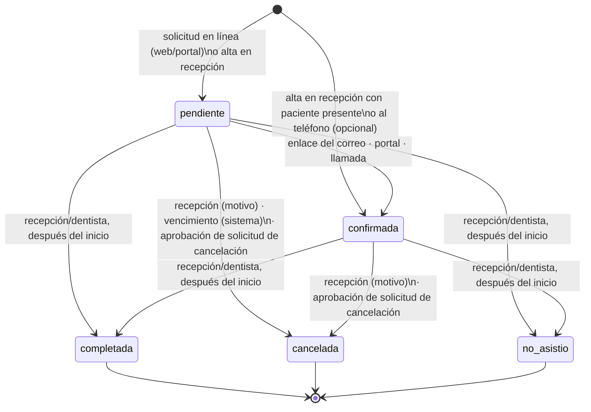

# Diseño de la Fase 2: agenda y citas

> **Estado:** propuesta en revisión. No se programa nada hasta su aprobación.
> **Rama:** `fase-2-agenda` (creada desde `fase-1-base-datos`; se rebasará sobre `main` cuando la Fase 1 se integre, antes del Paso 2).
> **Fecha:** 2026-11-23
> **Alcance:** toda la lógica de citas del backend y su contrato de API. El panel React no se toca (el panel nuevo es la Fase 3). El sitio y el portal (páginas) son de otra etapa; aquí se diseña solo su API.
> **Base:** `CLAUDE.md`, `docs/database/modelo-datos.md`, `docs/fase-1-informe.md`, `docs/requirements/requerimientos.md`.

Las decisiones que te corresponden están marcadas con **[DECIDE]** y reunidas en la sección 12. Donde hay una recomendación técnica lo digo; en la sección 2 no elijo, como pediste.

---

## 0. Punto de partida (lo que ya existe tras la Fase 1)

| Pieza | Estado | Qué cambia en la Fase 2 |
|---|---|---|
| `citas` con `inicio`/`fin` UTC, restricción `citas_sin_traslape_dentista` | Hecho | Se conserva como autoridad final. |
| `configuracion_agenda`, `horario_dias`, `horario_descansos`, `agenda_cierres` | Hecho; sembrado 8–16, descansos 11–12 y 14–15 | Se agregan columnas (sección 1.6 y 2). |
| `AgendaService.HorariosDelDiaAsync` / `HorariosDisponiblesAsync` | Simplificado: no considera duración múltiple, anticipación ni vencidas | Se sustituye por el motor de disponibilidad (sección 1). |
| `CitasController` (`POST`, `PUT`, `PATCH confirmar`, `PATCH cancelar`) | Hecho, lo usa `citas.jsx` | Se reorganiza en acciones por transición (sección 9). `PUT` y `horarios-disponibles` se conservan como compatibilidad hasta la Fase 3 **[aviso: no se borran]**. |
| `CitasRepository.GuardarAsync` reintenta 40P01 **en el mismo contexto** | Hecho | Pasa a reintentar en **contexto y transacción nuevos** (sección 6.3). |
| `cita_historial` con trigger de solo inserción (`UPDATE`, `DELETE`, `TRUNCATE`) | Hecho en `Inicial` | Ya cumple lo pedido para `cita_historial`; el commit 1 lo cubre con prueba de regresión y agrega el trigger de `citas`. |
| `notificaciones` | Solo la tabla | Se convierte en bandeja de salida (sección 7). |
| `citas.confirmacion_token_hash` / `_expira_en` | Columnas sin uso | Ver sección 5.2 **[DECIDE]**. |

---

## 1. Disponibilidad

### 1.1 Principios

1. **Toda regla de horario se evalúa en hora local de la clínica** (`Clinica:ZonaHoraria`, identificador IANA `America/Mexico_City`) y **todo instante se guarda en UTC**. Nunca se usa un desplazamiento fijo (`-06:00`): la conversión pasa siempre por la zona IANA, con su historial de reglas, en el único servicio de conversión que ya existe (`IRelojClinica`).
2. **Un solo motor de disponibilidad** (`IDisponibilidadService`) para todos los canales: el sitio, el portal, el panel y la validación de una reserva. La reserva **vuelve a calcular** la disponibilidad dentro de su transacción; lo que mostró la pantalla es solo orientativo.
3. **La hora "ahora" viene de `TimeProvider`**, no de `now()` en SQL. Así las pruebas controlan el reloj (anticipación, vencimientos) y la aplicación y la base no discrepan. Las consultas reciben "ahora" como parámetro.
4. La restricción de exclusión de la base sigue siendo la última barrera contra el traslape.

### 1.2 Entradas y salidas

```
Calcular(fechaLocal | rango de fechas, servicioId, canal, dentistaId?) →
    lista de { inicioLocal, inicioUtc, finUtc, dentistasLibres[] }
```

- `canal`: `en_linea` (sitio y portal) o `recepcion` (asistente y admin). Determina la anticipación mínima (1.5).
- `dentistaId`: solo lo pueden enviar asistente o admin (para reasignar o agendar con alguien concreto). Los canales en línea nunca lo reciben ni lo ven.
- La respuesta pública (sección 9) solo lleva las horas; `dentistasLibres` nunca sale por un endpoint público.

### 1.3 Algoritmo (por fecha local)

1. **Día laborable.** Se toma `horario_dias` del día de la semana ISO (1 lunes … 7 domingo). Si no es laborable → sin horarios.
2. **Cierres.** Si hay un `agenda_cierres` de todo el día para esa fecha → sin horarios. Los cierres parciales se tratan como descansos de ese día.
3. **Horarios base.** Desde `hora_apertura`, en pasos de `duracion_slot_minutos`, se generan inicios `t` mientras `t + duracion_slot ≤ hora_cierre`. Con la configuración actual: 8, 9, 10, 11, 12, 13, 14, 15.
4. **Bloques no disponibles del día** = descansos con `dia_semana` nulo o igual al día + cierres parciales.
5. **Duración en espacios consecutivos.** Para un servicio de `n = servicios.duracion_slots`, el intervalo candidato es `[t, t + n × duracion_slot)`. Es válido solo si:
   - `t` es un inicio base (paso 3);
   - el intervalo completo termina a más tardar en `hora_cierre`;
   - **no se cruza con ningún descanso ni cierre** (una cita larga no puede atravesar un descanso: con 11–12 de descanso, un servicio de 2 espacios no puede empezar a las 10).
   Con la configuración actual, los inicios válidos para 1 espacio son 8, 9, 10, 12, 13, 15; para 2 espacios, 8, 9 y 12.
6. **Conversión a UTC.** `inicioUtc = Reloj.AUtc(fecha, t)`, `finUtc = inicioUtc + n × duracion_slot`. Casos de cambio de horario (hoy México no los aplica, pero la regla IANA podría volver): si la hora local **no existe** (salto hacia adelante) el horario se omite; si es **ambigua** (retroceso) se usa la primera ocurrencia. Queda cubierto por una prueba con una zona que sí tiene horario de verano.
7. **Anticipación y horizonte.** Se descarta todo inicio con `inicioUtc < ahora + anticipación(canal)` y todo inicio posterior a `hoy + horizonte_reserva_dias` (1.6).
8. **Dentistas elegibles.** Activos, no eliminados y que ofrecen el servicio según `dentista_servicios`. **[DECIDE]** qué pasa si un servicio no tiene ningún dentista ligado: propuesta, lo puede atender cualquier dentista activo (regla de transición mientras se captura el catálogo).
9. **Ocupación.** Para cada dentista elegible se buscan citas que se traslapen con `[inicioUtc, finUtc)` y que **bloqueen**:
   - `confirmada`, o
   - `pendiente` **sin vencer**: `bloqueo_expira_en IS NULL` (creada por recepción) o `bloqueo_expira_en > ahora`.
   Las pendientes ya vencidas **no** bloquean en el cálculo: la reserva las cancela dentro de su propia transacción (sección 6.1), así que mostrarlas como ocupadas solo escondería horarios reales.
10. **Resultado.** Un horario está disponible si queda al menos un dentista elegible libre durante todo el intervalo. La capacidad sale sola: una cita por dentista activo y por horario, sin entidad de consultorio.

### 1.4 Consultas y rendimiento

- Una consulta por rango: citas que bloquean de los dentistas elegibles entre el primer y el último instante del rango, con el índice `(dentista_id, inicio)` ya existente. El resto se calcula en memoria.
- La disponibilidad pública acepta como máximo 14 días por consulta (configurable) para acotar el costo.
- Sin caché en esta fase: el volumen de una clínica de una sucursal no lo requiere, y una caché complicaría la coherencia con la reserva.

### 1.5 Anticipación mínima

- Se mueve a **minutos** para poder expresar reglas como 90 minutos (sección 2): `anticipacion_minima_en_linea_minutos` y `anticipacion_minima_recepcion_minutos`.
- **Valor por defecto: 60 minutos** (lo que indicó el dueño). **[DECIDE]** si la recepción usa la misma (60) o puede agendar hasta el inicio (0). El requerimiento 5.5 dice que recepción puede agendar "sin ese límite, hasta una hora antes"; la propuesta es 60 para ambos y que la sección 2 decida si el canal en línea necesita más.
- Recepción nunca puede agendar en el pasado (`inicioUtc > ahora` siempre).

### 1.6 Cambios de esquema que propone esta sección (migración nueva)

| Tabla | Cambio | Motivo |
|---|---|---|
| `configuracion_agenda` | `anticipacion_minima_horas` → se sustituye por `anticipacion_minima_en_linea_minutos smallint` y `anticipacion_minima_recepcion_minutos smallint`, con `CHECK >= 0` | Granularidad en minutos y regla por canal. La migración convierte el valor existente. |
| `configuracion_agenda` | `horizonte_reserva_dias smallint NOT NULL DEFAULT 60`, `CHECK > 0` | Evita solicitudes a meses vista y acota el cálculo. **[DECIDE]** el valor. |
| `configuracion_agenda` | Columnas que resulten de la sección 2 (p. ej., `ventana_minima_bloqueo_minutos`) | Según tu decisión. |

El servicio de datos iniciales actualiza sus valores por defecto. **[DECIDE]** si la migración debe cambiar también la fila ya sembrada en tu base local (hoy `anticipacion_minima_horas = 2`) a 60 minutos, o si se ajusta a mano.

---

## 2. Choque entre anticipación y vencimiento del bloqueo

### 2.1 El problema

Regla vigente (modelo 9.1.3), solo para origen `web` y `portal`:

```
bloqueo_expira_en = min(creado + 24 h, inicio − 2 h)
```

Sea `Δ = inicio − creado` (cuánto antes se solicita) y `W = bloqueo_expira_en − creado` (tiempo que tiene la clínica para confirmar):

| Δ (antelación) | W (ventana para confirmar) | Situación |
|---|---|---|
| 1 h (mínimo permitido con anticipación de 60 min) | −1 h | **Nace vencida**: el espacio se libera antes de existir. |
| 1 h 30 min (tu ejemplo) | −30 min | Nace vencida. |
| 2 h | 0 | Nace vencida. |
| 2 h 15 min | 15 min | Casi imposible llamar a tiempo. |
| 10 h | 8 h | Razonable si es en horario de atención. |
| 26 h o más | 24 h | Tope de 24 h. |

Con anticipación de 60 minutos y liberación de 2 horas, **toda solicitud hecha con menos de 2 horas de antelación nace vencida**, y las que se hacen poco después del límite tienen minutos para confirmarse.

Hay además un **segundo problema que la regla no ve**: el reloj corre aunque la clínica esté cerrada.

- Solicitud del sábado a las 20:00 para el lunes a las 8:00: `Δ = 36 h`, `W = 24 h` → vence el **domingo a las 20:00**, sin que recepción haya abierto. El horario se libera sin que nadie pudiera llamar.
- Solicitud del martes a las 18:00 para el miércoles a las 8:00: `Δ = 14 h`, vence a las **6:00 del miércoles**, antes de abrir.

Si el paciente no confirma por correo, una parte grande de las solicitudes nocturnas o de fin de semana se pierde sin que recepción haya tenido oportunidad.

Cualquiera que sea la opción, propongo agregar en la base `CHECK (bloqueo_expira_en IS NULL OR bloqueo_expira_en > creado_en)`, para que una solicitud nunca pueda guardarse ya vencida.

### 2.2 Opciones (no elijo; tú decides)

**A. Anticipación en línea mayor que la liberación.**
- **Regla:** `anticipacion_minima_en_linea = liberación + ventana mínima` (p. ej., 2 h + 1 h = 3 h). Recepción conserva 60 min.
- **A favor:** la más simple; garantiza `W ≥ 1 h`; no cambia la fórmula.
- **En contra:** el sitio no ofrece horarios de las próximas 3 horas aunque estén libres; no resuelve el problema nocturno ni de fin de semana.

**B. Ventana mínima de bloqueo.**
- **Regla:** `bloqueo_expira_en = min(inicio, max(creado + Vmin, min(creado + 24 h, inicio − 2 h)))`, con `Vmin` configurable (p. ej., 30 min).
- **A favor:** el sitio puede ofrecer horarios hasta 60 min antes; toda solicitud tiene al menos `Vmin`.
- **En contra:** con `Δ = 90 min` y `Vmin = 30 min`, el espacio queda bloqueado hasta 60 min antes de la cita; si nadie confirma, se libera cuando ya es difícil volver a ocuparlo. No resuelve el problema nocturno.

**C. Solicitudes de último momento sin vencimiento automático.**
- **Regla:** si `Δ < liberación + Vmin`, `bloqueo_expira_en = inicio` y la solicitud se marca **urgente**, con notificación interna inmediata a recepción.
- **A favor:** no se pierde ninguna solicitud cercana; recepción decide.
- **En contra:** depende de que recepción atienda a tiempo; un abuso podría bloquear horarios del día. Se mitiga con el tope por contacto (sección 8).

**D. Sin solicitudes en línea de último momento.**
- **Regla:** el sitio solo ofrece horarios con `Δ ≥ umbral` (p. ej., 3 h). Para antes, muestra "Para hoy, llámanos o escríbenos por WhatsApp".
- **A favor:** sin bloqueos inútiles; el contacto urgente es humano.
- **En contra:** igual que A en cuanto a horarios visibles; requiere el teléfono o WhatsApp en el sitio.

**E. Vencimiento en horas de atención.**
- **Regla:** las 24 h y las 2 h se cuentan solo en horario de atención (de `horario_dias`, sin descansos ni cierres). La solicitud del sábado a las 20:00 vencería el lunes durante la mañana, o 2 h de atención antes de la cita.
- **A favor:** resuelve el problema nocturno y de fin de semana; es la regla que mejor refleja "recepción tiene tiempo de llamar".
- **En contra:** la más compleja de explicar y de probar. Combinada con citas a primera hora, puede requerir la regla C para el caso de `Δ` pequeño.

**F. Confirmación automática de último momento.**
- **Regla:** con `Δ < umbral`, la cita nace confirmada.
- **A favor:** no se bloquea nada sin dueño.
- **En contra:** abre la puerta a reservas falsas y a inasistencias sin ningún filtro. Solo la menciono para descartarla de forma explícita.

**Combinaciones posibles:** A o D para el corto plazo (qué se ofrece) y E o B para la ventana (cuánto dura el bloqueo). Por ejemplo, "D con umbral de 3 h + E" o "B + C".

**[DECIDE]**:
- (a) qué opción o combinación;
- (b) los valores (`umbral`, `Vmin`);
- (c) si quieres el `CHECK` de la base.

Hasta tu decisión, el diseño trata la fórmula de vencimiento como **una sola función** (`CalcularBloqueo(creado, inicio, config)`) para que cualquier opción cambie solo ese punto y sus pruebas.

---

## 3. Asignación de dentista

### 3.1 Regla general

El paciente nunca elige ni ve a qué dentista se le asigna en el momento de solicitar. La asignación ocurre **dentro de la transacción de la reserva**, entre los dentistas elegibles y libres que calculó el motor (1.3, pasos 8 y 9).

### 3.2 Un solo dentista activo

Se asigna automáticamente. Si no está libre, el horario no se ofrece.

### 3.3 Varios dentistas: criterio propuesto **[DECIDE]**

Orden de preferencia, de forma determinista para poder probarlo:

1. **Continuidad:** si el paciente ya tiene citas (completadas, confirmadas o pendientes) con un dentista elegible y libre, ese dentista. Solo aplica a pacientes identificados (con cuenta o creados por recepción); un invitado nuevo no tiene historial.
2. **Menor carga del día:** el dentista con menos citas activas ese día local.
3. **Menor carga de la semana.**
4. **Desempate:** el `id` menor.

**Alternativas:**
- **Rotación pura (round-robin):** reparte igual, pero ignora la continuidad del tratamiento.
- **Dentista "por defecto" por servicio:** requiere una columna de prioridad en `dentista_servicios`.

### 3.4 Reasignación por la asistente

- **Acción:** `PATCH /api/citas/{id}/dentista` con el dentista nuevo y un motivo.
- **Quién:** asistente o admin.
- **Estados permitidos:** pendiente o confirmada.
- Mismo horario; se valida con el motor (el dentista nuevo debe ser elegible y estar libre) y con la restricción de la base.
- Historial y bitácora con el antes y el después.
- **[DECIDE]** si el paciente recibe un correo por el cambio de dentista. Propuesta: no, salvo que el correo de confirmación ya mencionara al dentista. Para eso habría que decidir también si los correos muestran el nombre del dentista; propuesta: **no**.
- Para el historial hace falta una acción nueva `reasignacion` en el `CHECK` de `cita_historial.accion` (migración nueva). La alternativa es usar `modificacion`, que es menos claro.

### 3.5 Baja de un dentista

Si un dentista se desactiva o se elimina con citas futuras activas, **no** se reasignan solas: el panel muestra la lista "citas por reasignar" (`GET /api/citas?dentistaInactivo=true`) y la asistente decide. Una reasignación automática podría asignar a alguien que el paciente no espera.

---

## 4. Flujo de la cita: estados y transiciones

### 4.1 Diagrama



### 4.2 Tabla de transiciones válidas

| Desde | Hacia | Quién | Canal en historial | Condiciones |
|---|---|---|---|---|
| — | pendiente | Anónimo (sitio), paciente (portal) | `web` / `portal` | Disponibilidad en línea; `bloqueo_expira_en` según la sección 2; tope por contacto. |
| — | pendiente | Asistente, admin | `panel` | Disponibilidad de recepción; `bloqueo_expira_en = NULL`. |
| — | confirmada | Asistente, admin | `llamada` / `panel` | **[DECIDE]** permitir crear ya confirmada (paciente presente o al teléfono). Propuesta: sí, con `confirmarAlCrear: true`. |
| pendiente | confirmada | Paciente con el enlace del correo | `correo` | Token válido; la solicitud **no vencida**. |
| pendiente | confirmada | Paciente (portal) | `portal` | Cita propia; no vencida. |
| pendiente | confirmada | Asistente, admin | `llamada` | Puede confirmar una pendiente **vencida que aún no se ha cancelado**, si el horario sigue libre: nadie lo ocupó. Limpia `bloqueo_expira_en`. |
| pendiente / confirmada | cancelada | Asistente, admin | `panel` / `llamada` | Motivo obligatorio (RN-02). |
| pendiente | cancelada | Sistema | `sistema` | Vencimiento (sección 6). Motivo fijo: "Solicitud no confirmada a tiempo". |
| pendiente / confirmada | cancelada | Asistente, admin al aprobar una solicitud de cancelación | `llamada` | Ver 4.4. |
| pendiente / confirmada | (mismo estado, otro horario) | Asistente, admin | `panel` / `llamada` | **Reagenda**: valida disponibilidad del nuevo horario (RN-03); ver 4.5. |
| pendiente / confirmada | completada | Asistente, admin; dentista sobre sus citas **[DECIDE]** | `panel` | Solo si `ahora ≥ inicio`. |
| pendiente / confirmada | no_asistio | Asistente, admin; dentista sobre sus citas **[DECIDE]** | `panel` | Solo si `ahora ≥ inicio`. **[DECIDE]** si además se exige un margen (p. ej., 15 min después del inicio). |
| completada / cancelada / no_asistio | cualquiera | Nadie | — | Estados finales. **[DECIDE]** si el admin puede corregir un `no_asistio` ↔ `completada` registrado por error (propuesta: sí, solo admin, con motivo y dentro de 7 días). |

- **Implementación:** una sola clase `TransicionesCita` decide si una transición es válida. Los controladores no repiten reglas (`CLAUDE.md` §4.7).
- **Transición inválida:** `409` con código `TRANSICION_INVALIDA` y mensaje en español ("Una cita cancelada no se puede confirmar").
- **Concurrencia optimista:** se usa la columna de sistema `xmin` de PostgreSQL como token de concurrencia en `citas` (sin cambio de esquema). Si dos personas cambian la misma cita a la vez, la segunda recibe `409 CITA_MODIFICADA` ("La cita cambió mientras la editabas; recarga").

### 4.3 Solicitud desde invitado o paciente con cuenta

**Invitado (sitio, anónimo):**
- **Datos:** nombre, apellido, correo o teléfono (al menos uno), servicio, fecha, hora, motivo opcional, aceptación del aviso de privacidad y el campo trampa (sección 8).
- **No se busca un paciente existente por correo ni por teléfono.** Siempre se crea un `pacientes` nuevo con `origen = web` y `contacto_verificado = false`. Así la respuesta no depende de si el contacto ya existía (sin enumeración) y nadie puede agregar citas al expediente de otra persona escribiendo su correo.
- La fusión de duplicados la hace recepción desde el panel. Es una herramienta de una fase posterior; aquí solo se deja anotada. **[DECIDE]** si entra en esta fase.

**Paciente con cuenta (portal):** usa su propia ficha (`usuarios → pacientes`); el contacto sale de la ficha, no del formulario.

**Dentro de una transacción:**
1. Liberación de vencidas.
2. Asignación de dentista.
3. Alta de la cita (`pendiente`, `bloqueo_expira_en`).
4. `cita_historial` (`creacion`).
5. Bitácora (interceptor).
6. Notificaciones en la bandeja de salida: correo "solicitud recibida" con enlace, si hay correo; aviso interno a recepción.

**Respuesta:**
- Pública: `202 Accepted` con un mensaje genérico, sin datos de la cita.
- Portal: `201` con la cita propia.

### 4.4 Solicitud de reprogramación o cancelación del paciente

- **Quién y por dónde:**
  - Paciente con cuenta: desde el portal.
  - Invitado: desde el enlace de gestión del correo (sección 5).
- **Efecto:** llena el indicador `solicitud_cambio_tipo` (`reagendar` o `cancelar`), el motivo y la fecha. **La cita conserva su horario y su estado.**
  - Solo puede haber una solicitud abierta por cita; una segunda la reemplaza y queda en el historial.
  - **[DECIDE]** si una solicitud de **cancelación** sobre una cita aún **pendiente** se aprueba sola, para liberar el horario sin esperar a recepción. Propuesta: sí; el paciente no está pidiendo nada que la clínica deba negociar.
- **Resolución por recepción:** `POST /api/citas/{id}/solicitud-cambio/resolver`.
  - Aprobar una cancelación → `cancelada`, con la solicitud como motivo.
  - Aprobar una reagenda → reagenda al horario que se acordó por teléfono, en la misma operación.
  - Rechazar → limpia el indicador, con motivo.
  - Historial `solicitud_cambio` y `resolucion_solicitud`; correo al paciente con el resultado.

### 4.5 Reagenda y sesiones siguientes de un tratamiento

- **Reagenda:** `PATCH /api/citas/{id}/reagendar` (asistente o admin) con fecha, hora, dentista opcional y motivo.
  - Valida con el motor de recepción y libera vencidas en el horario nuevo.
  - El costo se recalcula solo si cambia la fecha y con ella la oferta vigente. **[DECIDE]** si se conserva el precio original; propuesta: conservarlo.
  - Estado resultante: lo elige recepción. `confirmada` si se acordó por teléfono; `pendiente` si se envía un correo nuevo para confirmar. **[DECIDE]** el valor por defecto.
- **Sesiones siguientes:** sin tabla de planes en esta fase (modelo 9.3). La asistente crea cada sesión como una cita normal desde el panel (`POST /api/citas`), opcionalmente ya confirmada.
  - **[DECIDE]** si cada sesión se confirma por separado (pendiente del requerimiento 6). Propuesta: sí, como cualquier cita.
  - El enlace a un plan llegará con la columna aditiva `plan_tratamiento_sesion_id` de una fase posterior.

### 4.6 Historial

- Cada transición escribe `cita_historial` en el mismo `SaveChanges` que el cambio (ya implementado en la Fase 1 para el panel).
- **Canales:** `panel`, `llamada`, `correo`, `portal`, `web`, `sistema`. Propuesta: agregar un `CHECK` de canal y las acciones `reasignacion`, `vencimiento` y `reenvio_enlace` (migración nueva).
- **Corrección de privacidad (hallazgo al diseñar):** hoy la cancelación guarda el **motivo** en `cita_historial.detalle`. Un motivo libre puede contener datos de salud ("dolor fuerte", "embarazo"), y `cita_historial` no se puede corregir ni borrar. Propuesta:
  - El historial guarda un texto genérico ("Cancelada por recepción") y deja el motivo solo en la fila de `citas`.
  - `citas.motivo`, `motivo_cancelacion` y `solicitud_cambio_motivo` se marcan `[DatoSensible]` en la bitácora.
  - **[DECIDE]**, porque cambia lo hecho en la Fase 1.

---

## 5. Enlaces por correo

### 5.1 Token

- **Generación:** 32 bytes de `RandomNumberGenerator`, codificados en base64url (43 caracteres).
- **Almacenamiento:** solo el hash **SHA-256** en hexadecimal; el token en claro existe únicamente en el correo y en la memoria del proceso que lo envía (ver 7.3: el token se genera **al enviar**, no al crear la cita, para que la bandeja de salida nunca guarde un token en claro).
- **Un solo uso por propósito:** la acción se ejecuta con un `UPDATE` condicional (`WHERE hash = @h AND usado_en IS NULL AND expira_en > @ahora`) dentro de la transacción del cambio. Dos clics simultáneos: uno gana y el otro ve "ya usado".
- **Vencimiento:**
  - Confirmar: `min(bloqueo_expira_en, inicio)`.
  - Gestionar (solicitar cambio): hasta el inicio de la cita.
- **Reenvío:** generar un enlace nuevo invalida los anteriores del mismo propósito.

### 5.2 Dónde se guarda **[DECIDE]**

- **Opción 1 (propuesta):** tabla nueva `cita_tokens`
  - Columnas: `id`, `cita_id`, `proposito` (`confirmar` o `gestionar`), `token_hash` único, `expira_en`, `usado_en`, `creado_en`.
  - Ventajas: permite los dos propósitos, el reenvío y la trazabilidad sin sobrescribir.
  - Las columnas `citas.confirmacion_token_hash` y `confirmacion_token_expira_en` quedarían sin uso; **no se borran** sin tu autorización.
- **Opción 2:** usar las columnas existentes para confirmar y agregar `gestion_token_hash` y `gestion_token_expira_en` a `citas`. Menos tablas, pero pierde el historial de tokens.

### 5.3 Página y endpoints

- El enlace apunta a `{Clinica:UrlPublica}/cita#t={token}`. El token va en el **fragmento (`#`)**, que el navegador no envía al servidor ni aparece en `Referer` ni en registros de proxy. La página lo lee y lo envía en el **cuerpo** de un `POST`.
- **Confirmar requiere un clic**, nunca un `GET`: los filtros de correo abren los enlaces para revisarlos y confirmarían la cita sin que el paciente lo haga.
- **Datos que muestra la página:** servicio, fecha y hora local, estado y nombre de la clínica.
  - **Sin** nombre del paciente, dentista, motivo, teléfono ni correo.
  - Así, si el correo se reenvía, revela lo mínimo.
- **Respuestas que no filtran información:**
  - Token alterado, inexistente o vencido → el mismo `404` "El enlace no es válido o ya venció".
  - Token ya usado para confirmar una cita confirmada → `200` "Tu cita ya está confirmada". Solo lo ve quien tiene el token.
- **Cabeceras:** `Cache-Control: no-store` y `Referrer-Policy: no-referrer`.
- **Página web pendiente [DECIDE]:** el sitio (Astro) es de otra etapa. Mientras tanto:
  - (a) una página estática mínima servida por el backend (`wwwroot/cita.html`, sin datos incrustados), o
  - (b) los correos llevan el enlace, pero la página llega con el sitio y, entretanto, la confirmación es por llamada.

### 5.4 Sin enumeración

- `POST` de solicitud: mismo código y cuerpo exista o no el correo o teléfono; no se busca ningún paciente (4.3).
- Tope por contacto: ver 8.2 (la respuesta tampoco cambia).
- Los endpoints de enlace solo responden sobre la cita del token.
- **Pendientes fuera de alcance:** `POST /api/auth/register` y `POST /api/usuarios` todavía enumeran correos (pendiente P9 de la Fase 0). **[DECIDE]** si se corrige en esta fase; propuesta: sí, en un commit aparte, porque el portal va a exponer el registro.

---

## 6. Vencimiento de pendientes y reintentos

### 6.1 Liberación dentro de la reserva

En toda transacción que **ocupa** un horario (alta, reagenda, reasignación):

1. Se toma un **candado de aplicación** de PostgreSQL por fecha local: `pg_advisory_xact_lock(hash('agenda:' || fecha))`.
   - Con dos fechas (reagenda), en orden ascendente para no interbloquear.
   - Serializa las reservas del mismo día, lo que en una clínica de una sucursal no limita la capacidad.
   - Elimina casi todos los 40P01 de la restricción de exclusión, que vimos en la Fase 1.
2. Se cancelan las `pendiente` con `bloqueo_expira_en <= ahora` que se traslapan con el intervalo, para los dentistas candidatos.
   - Motivo "Solicitud no confirmada a tiempo", historial `vencimiento` (canal `sistema`), bitácora y notificación al paciente **[DECIDE]**.
3. Se recalcula la disponibilidad y se asigna el dentista.
4. Se inserta o mueve la cita. La restricción de exclusión sigue como respaldo.

El candado es una propuesta técnica: la alternativa es depender solo de los reintentos. La recomiendo porque convierte una carrera en una espera corta y hace los mensajes deterministas.

### 6.2 Barrido en segundo plano

- `BarridoVencidasService` (`BackgroundService` con `PeriodicTimer`) cada `Agenda:BarridoMinutos` (propuesta: 5 min).
- Toma lotes de hasta 100 pendientes vencidas con `FOR UPDATE SKIP LOCKED` y las cancela igual que en 6.1. Cada lote va en su propia transacción.
- Funciona con más de una instancia de la API: un `pg_try_advisory_lock` del barrido evita trabajo duplicado.
- **Carrera con una confirmación:** la confirmación actualiza `WHERE estado = 'pendiente' AND bloqueo_expira_en > @ahora`; el barrido actualiza `WHERE … <= @ahora`. Con el bloqueo de fila de PostgreSQL, solo una de las dos tiene efecto; la otra afecta 0 filas y responde en consecuencia.

### 6.3 Reintentos acotados

Toda operación que reserva usa `EjecutarReservaAsync(operación)`:

- Cada intento abre **un `DbContext` nuevo y una transacción nueva**: nada del intento anterior queda en el rastreador de cambios. Esto corrige el reintento actual de `CitasRepository`, que reutiliza el contexto.
- **Errores que se reintentan:**
  - `40P01` (interbloqueo);
  - `23P01` (traslape), porque otra reserva ganó y el reintento recalcula: puede asignar a otro dentista libre o concluir que ya no hay lugar.
- **Máximo de 3 intentos**, con espera aleatoria corta entre intentos (25–150 ms).
- **Si se agotan**, o el reintento confirma que ya no hay lugar, la respuesta es `409`, en español:
  - Público y portal: `HORARIO_NO_DISPONIBLE`, "Ese horario acaba de ocuparse. Elige otro, por favor."
  - Panel: `HORARIO_OCUPADO`, "El dentista ya tiene una cita en ese horario."
- Cualquier otro error no se reintenta.

---

## 7. Correo

### 7.1 Abstracción

```csharp
public interface IEmailSender
{
    Task EnviarAsync(MensajeCorreo mensaje, CancellationToken ct);
}
// MensajeCorreo: Para, Asunto, CuerpoTexto, CuerpoHtml
```

**Implementaciones:**
- `SmtpEmailSender`: SMTP genérico con MailKit.
  - **Desarrollo:** apunta a **Mailpit** (`localhost:1025`), que captura los correos y los muestra en `http://localhost:8025`; nunca salen a internet.
  - **Producción:** apunta al SMTP del proveedor que se elija (cualquiera que ofrezca SMTP con TLS). El diseño no depende de ningún proveedor.
- `EmailSenderEnMemoria`: solo para pruebas; guarda los mensajes para comprobarlos.

**Configuración** (user-secrets en desarrollo, variables de entorno en producción; nunca en `appsettings.json`):
- `Correo:Habilitado`
- `Correo:Remitente`, `Correo:NombreRemitente`
- `Correo:Smtp:Host`, `Correo:Smtp:Puerto`, `Correo:Smtp:Usuario`, `Correo:Smtp:Password`, `Correo:Smtp:Seguridad` (`StartTls` o `SslOnConnect`)
- `Clinica:UrlPublica`

Si `Correo:Habilitado = false`, la bandeja acumula y no envía.

**docker-compose:** servicio `mailpit` (imagen `axllent/mailpit` con versión fija), puertos `127.0.0.1:1025` y `127.0.0.1:8025`. Solo para desarrollo.

### 7.2 Plantillas en español

Una clase por plantilla, con texto plano y HTML sencillo, y datos codificados para HTML. Sin motor externo.

| Plantilla | Cuándo | Contenido mínimo |
|---|---|---|
| `solicitud_recibida` | Solicitud en línea | Servicio, fecha y hora, "aún no está confirmada", enlace para confirmar y enlace para gestionar. |
| `confirmacion` | Al confirmarse por cualquier canal | Servicio, fecha, hora, dirección de la clínica, enlace para gestionar. |
| `recordatorio` | **[DECIDE]** 24 h antes (propuesta) | Igual que confirmación. |
| `cambio` | Reagenda o reasignación (si se decide avisar) | Horario anterior y nuevo. |
| `cancelacion` | Cancelación por recepción o aprobada | Fecha y "si fue un error, llámanos". **Sin** el motivo (puede ser sensible). |
| `solicitud_cambio_recibida` | El paciente pidió un cambio | "Te llamaremos para confirmarlo". |
| `vencimiento` | **[DECIDE]** si se avisa | "Tu solicitud no se confirmó a tiempo; puedes solicitar otro horario". |

Ningún correo lleva datos de salud, CURP ni motivo. Los datos de la clínica (nombre, dirección, teléfono) salen de configuración. **[DECIDE]** dónde: `appsettings` o una tabla editable por el admin.

### 7.3 Bandeja de salida sobre `notificaciones`

- **Patrón de bandeja de salida:** la fila de `notificaciones` (canal `correo`) se escribe en la **misma transacción** que el cambio de la cita. Si la transacción falla, no hay correo; si el envío falla, el correo no se pierde.
- **La fila no guarda el cuerpo renderizado ni el token.** Guarda la plantilla y la referencia (`cita_id`, `paciente_id`, `tipo`). El trabajador de envío:
  1. lee la cita y el correo de contacto vigente (`pacientes.correo`, regla 5 del modelo);
  2. genera el token si la plantilla lo necesita (guarda solo su hash);
  3. renderiza y envía.
- **Trabajador `EnvioCorreosService`:**
  - Se despierta cada 30 s o al recibir un aviso tras un commit.
  - Reclama lotes con `FOR UPDATE SKIP LOCKED` y un arrendamiento (`procesando_desde`, 10 min) para tolerar caídas.
- **Reintentos:**
  - Esperas de 1 min, 5 min, 15 min, 1 h y 6 h; a la 6.ª falla, `fallida`.
  - Al marcarse `fallida`, se crea una notificación interna para recepción ("No se pudo enviar el correo de la cita del día…; contacta al paciente").
  - `error_envio` guarda solo el código o la clase del error del servidor SMTP, nunca la dirección ni el contenido.
- **Entrega "al menos una vez":** si el proceso cae justo después de enviar y antes de marcar, el correo puede repetirse. Es aceptable para estos avisos y queda documentado.
- **Paciente sin correo** (solo teléfono): no se crea notificación de correo; se crea una interna para que recepción llame o escriba por WhatsApp.

**Cambios de esquema (migración nueva):**

| Tabla | Cambio |
|---|---|
| `notificaciones` | `estado text CHECK IN ('pendiente','procesando','enviada','fallida','descartada')`, `intentos smallint DEFAULT 0`, `proximo_intento_en timestamptz`, `procesando_desde timestamptz`, `plantilla text`. Índice parcial `(proximo_intento_en) WHERE estado = 'pendiente'`. |
| `notificaciones.tipo` | Ampliar el `CHECK` con `vencimiento`, `reasignacion` y `envio_fallido`. |
| `notificaciones` | Se conservan `enviada` y `enviada_en` por compatibilidad. **[DECIDE]** si se dejan derivadas del estado o se retiran en una fase posterior. |

---

## 8. Abuso y privacidad

### 8.1 Límite de tasa (endpoints públicos)

Se amplía `RateLimitingSetup` con particiones nuevas. Todos los valores son configurables; las respuestas son `429` con `Retry-After` y mensaje en español.

| Endpoint | Partición | Propuesta |
|---|---|---|
| `GET /api/publico/disponibilidad` | IP | 60 por minuto |
| `POST /api/publico/citas` | IP | 5 por hora |
| `POST /api/publico/citas` | Correo normalizado (minúsculas, sin espacios) | 3 por día |
| `POST /api/publico/citas` | Teléfono normalizado (solo dígitos, con lada de México) | 3 por día |
| Enlaces (`/api/publico/enlaces/*`) | IP | 20 por 10 minutos |

- **Detrás de un proxy:** antes de publicar, `ForwardedHeaders` solo con proxies conocidos (pendiente P6). Si no, todos los visitantes comparten la IP del proxy.
- **Memoria:** el límite vive en memoria; con más de una instancia habría que moverlo a un almacén compartido. Queda anotado.

### 8.2 Tope de solicitudes pendientes por contacto

- **Regla:** como máximo `Agenda:MaxPendientesPorContacto` (propuesta: 2) citas `pendiente` futuras cuyo paciente tenga el mismo correo o teléfono normalizado.
- **Teléfonos comparables:** se normalizan al escribirse. Propuesta: columna generada `telefono_normalizado` con índice; es un cambio de esquema en migración nueva.
- **Respuesta sin revelar nada [DECIDE]:**
  - **Opción 1 (propuesta):** la API responde el mismo `202` genérico, no crea la cita y, si hay correo, envía al contacto "ya tienes solicitudes pendientes; confírmalas o llámanos". Solo el dueño del correo se entera.
  - **Opción 2:** `409` "No pudimos registrar la solicitud; llámanos". Es más claro para el usuario, pero revela a quien pruebe un contacto ajeno que ese contacto tiene solicitudes pendientes.

### 8.3 Campo trampa y CAPTCHA

- **Campo trampa:** un campo `sitioWeb` oculto con CSS en el formulario.
  - Si llega con valor, la API responde el mismo `202` y descarta la solicitud.
  - Registra un evento en la bitácora (`solicitud_descartada`, sin datos del formulario, solo IP y motivo `campo_trampa`).
- **Tiempo mínimo de llenado (opcional):** la página incluye la marca de tiempo de carga firmada con HMAC. Un envío en menos de 3 s se descarta igual.
- **CAPTCHA [DECIDE]:** el requerimiento 10 lo pide de forma explícita. Propuesta:
  - Implementar la interfaz `IVerificadorCaptcha`, desactivada por configuración, y activar Cloudflare Turnstile o hCaptcha si aparece abuso.
  - Ambos son servicios de terceros que reciben la IP y señales del navegador: requiere mención en el aviso de privacidad (validación legal).
  - Si prefieres cumplir el requerimiento desde el inicio, se activa desde el primer despliegue.

### 8.4 Datos

- Ningún endpoint público devuelve datos de pacientes ni de salud. La disponibilidad solo devuelve horas; los enlaces, lo indicado en 5.3.
- El motivo de la solicitud es texto libre que puede contener salud: se guarda solo en `citas.motivo` (sensible en la bitácora, 4.6) y nunca se reenvía por correo.
- La bitácora conserva su regla: sin valores sensibles. Eventos nuevos (`solicitud_publica`, `solicitud_descartada`, `enlace_invalido`) sin contenido del formulario. **[DECIDE]** si `enlace_invalido` se registra: ayuda a detectar ataques, pero genera volumen.
- No se registran cuerpos de petición de los endpoints públicos ni tokens en los logs.
- **Aviso de privacidad:**
  - El formulario exige aceptarlo.
  - Propuesta: guardar la versión del aviso y la fecha de aceptación en `pacientes` (`aviso_privacidad_version`, `aviso_privacidad_aceptado_en`; migración nueva).
  - **[DECIDE]**, y validación legal: el consentimiento expreso para datos sensibles es requisito de la LFPDPPP.

---

## 9. Endpoints

**Convenciones:**
- **Errores:** `{ "mensaje": "…", "codigo": "…" }` en español, con códigos estables para los clientes. Los de validación usan ProblemDetails con mensajes por campo en español.
- **Fechas:** `fecha` en `yyyy-MM-dd` y `hora` en `HH:mm`, en hora local de la clínica; `inicio` y `fin` en ISO 8601 UTC.
- **Roles:** Anónimo, Paciente, Asistente, Dentista, Admin. "Recepción" = Asistente + Admin.

### 9.1 Públicos sin credencial (los dos que pediste)

| Método y ruta | Quién | Cuerpo / consulta | Respuestas |
|---|---|---|---|
| `GET /api/publico/disponibilidad?servicioId&desde&hasta` | Anónimo | `desde`/`hasta` en fechas locales; máximo 14 días | `200 [{ fecha, horas: ["08:00", …] }]` sin dentistas ni datos personales. `400` rango o servicio inválido (servicio inactivo = `400` genérico). `429`. `503 AGENDA_NO_CONFIGURADA`. |
| `POST /api/publico/citas` | Anónimo | `{ nombre, apellido, correo?, telefono?, servicioId, fecha, hora, motivo?, aceptaAvisoPrivacidad, sitioWeb }` | `202 { mensaje }` genérico (también si el campo trampa se llenó o se alcanzó el tope, opción 1 de 8.2). `400` validación. `409 HORARIO_NO_DISPONIBLE`. `429`. |

**Hacen falta endpoints anónimos adicionales [DECIDE]:** los enlaces del correo son anónimos (el token es la credencial), así que hay tres más que los dos que mencionaste, y el sitio necesitará el catálogo de servicios para el formulario. Propuesta:
- Los de enlaces entran en esta fase.
- El catálogo público llega con el sitio.

| Método y ruta | Quién | Cuerpo | Respuestas |
|---|---|---|---|
| `POST /api/publico/enlaces/consultar` | Anónimo con token | `{ token }` | `200 { servicio, fecha, hora, estado, acciones: ["confirmar","solicitar_cambio"] }`. `404 ENLACE_INVALIDO`. `429`. |
| `POST /api/publico/enlaces/confirmar` | Anónimo con token de confirmar | `{ token }` | `200 { estado: "confirmada" }` (también si ya estaba confirmada). `404 ENLACE_INVALIDO`. `409 CITA_NO_CONFIRMABLE` (cancelada o vencida: "La solicitud ya no está vigente; solicita otro horario"). `429`. |
| `POST /api/publico/enlaces/solicitar-cambio` | Anónimo con token de gestionar | `{ token, tipo: "reagendar"\|"cancelar", motivo }` | `202`. `404`. `409 TRANSICION_INVALIDA`. `429`. |

### 9.2 Portal del paciente (rol `paciente`)

| Método y ruta | Cuerpo | Respuestas |
|---|---|---|
| `GET /api/portal/citas?estado&desde&hasta` | — | `200` solo citas propias (sin datos de otros ni costos internos **[DECIDE]**). |
| `GET /api/portal/disponibilidad?servicioId&desde&hasta` | — | Igual que el público. |
| `POST /api/portal/citas` | `{ servicioId, fecha, hora, motivo? }` | `201` cita propia. `400`. `409 HORARIO_NO_DISPONIBLE`. `429` (tope por contacto, aquí sin ocultar: es su propia cuenta). |
| `POST /api/portal/citas/{id}/confirmar` | — | `200`. `404` si no es suya (no `403`, para no revelar que existe). `409`. |
| `POST /api/portal/citas/{id}/solicitud-cambio` | `{ tipo, motivo }` | `202`. `404`. `409`. |

### 9.3 Panel (recepción y dentista)

| Método y ruta | Quién | Cuerpo / consulta | Respuestas principales |
|---|---|---|---|
| `GET /api/citas?desde&hasta&dentistaId&estado&conSolicitud&dentistaInactivo&pagina` | Recepción | — | `200` paginado. |
| `GET /api/citas/{id}` | Recepción | — | `200`, `404`. |
| `GET /api/citas/{id}/historial` | Recepción | — | `200` (acción, fecha, usuario, canal, detalle). |
| `GET /api/citas/mi-agenda?desde&hasta` | Dentista | — | Existente. |
| `GET /api/agenda/disponibilidad?fecha&servicioId&dentistaId?` | Recepción | — | `200 [{ hora, dentistasLibres:[{id,nombre}] }]` con anticipación de recepción. |
| `POST /api/citas` | Recepción | `{ pacienteId, servicioId, fecha, hora, dentistaId?, motivo?, costoExtra?, motivoExtra?, confirmarAlCrear? }` | `201`. `400`. `409 HORARIO_OCUPADO`. |
| `PATCH /api/citas/{id}/confirmar` | Recepción | `{ canal: "llamada"\|"panel" }` | `200`. `409 TRANSICION_INVALIDA` / `CITA_MODIFICADA` / `HORARIO_OCUPADO` (vencida cuyo horario ya se ocupó). |
| `PATCH /api/citas/{id}/reagendar` | Recepción | `{ fecha, hora, dentistaId?, motivo, estadoResultante }` | `200`. `409`. |
| `PATCH /api/citas/{id}/dentista` | Recepción | `{ dentistaId, motivo }` | `200`. `409`. |
| `PATCH /api/citas/{id}/cancelar` | Recepción | `{ motivo }` | Existente; agrega `409` de transición y concurrencia. |
| `PATCH /api/citas/{id}/completar` | Recepción; dentista sobre las suyas **[DECIDE]** | — | `200`. `409` si `ahora < inicio`. |
| `PATCH /api/citas/{id}/no-asistio` | Ídem | — | Ídem. |
| `PATCH /api/citas/{id}/costos` | Recepción | `{ costoExtra, motivoExtra }` | `200`. |
| `POST /api/citas/{id}/solicitud-cambio/resolver` | Recepción | `{ aprobar, motivo, nuevoHorario?: { fecha, hora, dentistaId? } }` | `200`. `409`. |
| `POST /api/citas/{id}/reenviar-enlace` | Recepción | — | `202` (invalida el enlace anterior). `409` si la cita no es confirmable o el paciente no tiene correo. |
| `GET /api/notificaciones/internas?noLeidas` / `PATCH /api/notificaciones/{id}/leida` | Recepción | — | Bandeja interna (nuevas solicitudes, solicitudes de cambio, envíos fallidos, urgentes). |
| `GET /api/agenda/configuracion` / `PUT /api/agenda/configuracion` | Admin (lectura: recepción) | Duración, anticipaciones, bloqueo, liberación, horizonte, días y descansos | `200`, `400`. **[DECIDE]** qué pasa con citas futuras que queden fuera de un horario nuevo. Propuesta: se permite y se listan como "fuera de horario" para revisión manual; nunca se cancelan solas. |
| `GET/POST/DELETE /api/agenda/cierres` | Admin | `{ fecha, horaInicio?, horaFin?, motivo }` | `DELETE` es borrado físico de un cierre (no es dato clínico ni financiero). **[DECIDE]**. Crear un cierre sobre citas existentes devuelve la lista de citas afectadas, que no se cancelan solas. |

**Compatibilidad con el panel actual:**
- `PUT /api/citas/{id}` y `GET /api/citas/horarios-disponibles` se conservan, delegando en los servicios nuevos, y se marcan obsoletos. Se retiran con el panel nuevo de la Fase 3, previa autorización.
- El `PUT` actual permite cambiar el estado: se validará con la tabla de transiciones. Por ejemplo, hoy permite pasar a `completada` una cita futura; dejará de poder hacerlo. Es un cambio de comportamiento: te aviso.

---

## 10. Plan de pruebas (Testcontainers, PostgreSQL 17)

Todas usan reloj controlado (`FakeTimeProvider`) salvo las de concurrencia, que usan el real.

| Área | Casos |
|---|---|
| **Disponibilidad básica** | Lunes con la configuración sembrada → 8, 9, 10, 12, 13, 15. Domingo → vacío. Cierre de todo el día → vacío. Cierre parcial 12–14 → sin 12 ni 13. Descanso solo de sábado. |
| **Duración múltiple** | Servicio de 2 espacios → 8, 9, 12 (nunca 10, 13 ni 15). Una cita de 2 espacios ocupa los dos horarios para ese dentista. Un servicio de 2 espacios no cabe en un hueco de 1. |
| **Zona horaria** | Conversión con `America/Mexico_City` sin desplazamiento fijo. Con una zona con horario de verano (prueba aislada), la hora inexistente se omite y la ambigua toma la primera ocurrencia. Las fechas en el límite de medianoche UTC caen en el día local correcto. |
| **Anticipación** | Con 60 min: a las 10:59 se ofrece las 12; a las 11:01, no. Recepción frente al canal en línea según la decisión. Horizonte: el día 61 no se ofrece. |
| **Bloqueo y vencimiento** | Fórmula según la decisión de la sección 2 (tabla de casos de 2.1). `CHECK` de la base si se aprueba. Una pendiente vencida no bloquea la disponibilidad. Reservar sobre una vencida la cancela en la misma transacción (historial `vencimiento`). El barrido cancela vencidas y no toca las vigentes ni las de recepción. Carrera barrido frente a confirmación: exactamente una gana. |
| **Asignación** | Un dentista → automático. Varios → continuidad, menor carga y desempate por id. Servicio sin dentistas ligados según la decisión. Reasignación a un dentista ocupado → `409`. |
| **Concurrencia** | 2 solicitudes simultáneas por el mismo horario con un dentista → una `202` y una `409`. 10 simultáneas → exactamente una gana y las otras 9 reciben `409`, sin `500`. Con 2 dentistas y 10 solicitudes → exactamente 2 ganan, una por dentista. Reagenda simultánea de dos citas al mismo horario. Ningún `500` en ninguna corrida (se repite la suite N veces en CI). |
| **Tokens** | Confirmar con un token válido. Reuso → "ya confirmada", sin segundo cambio ni segundo historial. Vencido → `404`. Alterado (un carácter) → `404`. Token de gestionar usado para confirmar → `404`. Reenvío invalida el anterior. La bandeja de salida y la base nunca contienen el token en claro (búsqueda del token en `notificaciones`, `auditoria`, `cita_historial` y logs capturados). |
| **Límites de tasa** | 6.ª solicitud por IP en una hora → `429`. 4.ª por el mismo correo con otra IP → `429`. Teléfono con y sin formato cuenta igual. Enlaces por IP. |
| **Abuso** | Campo trampa → `202` y no se crea nada. Tope de pendientes → `202` genérico y correo al contacto (o `409` según la decisión). Respuesta idéntica exista o no el correo. |
| **Transiciones** | Cada transición válida de la tabla 4.2 y cada inválida → `409 TRANSICION_INVALIDA`: confirmar cancelada, completar futura, cancelar completada, reagendar `no_asistio`, etc. Concurrencia optimista: dos cambios de la misma cita → el segundo recibe `409 CITA_MODIFICADA`. |
| **Solicitudes de cambio** | Paciente (portal y enlace) crea el indicador sin mover la cita. Aprobación de cancelación y de reagenda. Rechazo. Autoaprobación de la cancelación de una pendiente según la decisión. |
| **Historial** | Cada transición deja exactamente una fila con acción, canal y usuario correctos. El historial no contiene motivos libres (si se aprueba 4.6). `cita_historial` sigue rechazando `UPDATE`, `DELETE` y `TRUNCATE`. `citas` rechaza `DELETE` y `TRUNCATE`. |
| **Correo** | Bandeja de salida en la misma transacción: si la cita no se guarda, no hay notificación. Falla de SMTP → reintento con espera y, a la 6.ª, `fallida` más aviso interno. Paciente sin correo → solo aviso interno. Plantillas en español sin motivo ni datos de salud. Prueba de integración contra un contenedor de Mailpit. |
| **Privacidad** | Ningún endpoint público ni de enlaces devuelve nombre, correo, teléfono, motivo, dentista ni datos de salud. La bitácora no contiene motivos ni tokens. |
| **Autorización** | Matriz completa de los endpoints nuevos con los 4 roles y anónimo. Portal: la cita de otro paciente → `404`. |
| **Compatibilidad** | `PUT /api/citas/{id}` y `horarios-disponibles` siguen respondiendo al panel actual. |

---

## 11. Plan de commits

Rama `fase-2-agenda`, rebasada sobre `main` antes de empezar. Cada commit compila, pasa todas las pruebas y se reporta. Los commits con cambio de esquema son migraciones **nuevas**; la `Inicial` no se toca.

| # | Commit | Contenido |
|---|---|---|
| 1 | `feat(db): citas sin borrado físico` | Migración nueva: trigger `BEFORE DELETE` por fila y `BEFORE TRUNCATE` por sentencia en `citas`. `cita_historial` ya rechaza `UPDATE`, `DELETE` y `TRUNCATE` desde la `Inicial`; se agrega su prueba de regresión junto a la nueva. Pruebas: `DELETE` y `TRUNCATE` de `citas` rechazados; los tres de `cita_historial` rechazados. |
| 2 | `feat(db): configuración de agenda por canal y horizonte` | Migración: anticipación en minutos por canal, horizonte y columnas de la decisión de la sección 2; `CHECK` de bloqueo si se aprueba; datos iniciales actualizados. |
| 3 | `feat(agenda): motor de disponibilidad` | `IDisponibilidadService` (secciones 1.3 a 1.5), con pruebas de disponibilidad, duración múltiple, zona horaria y anticipación. Sin endpoints. |
| 4 | `feat(agenda): endpoints de disponibilidad` | Público y de recepción; `horarios-disponibles` delega en el motor (compatibilidad). |
| 5 | `feat(agenda): reservas con candado, liberación y reintentos` | `EjecutarReservaAsync`, candado por fecha, liberación de vencidas y reintentos en contexto nuevo. El `POST /api/citas` del panel pasa a usarlo. Pruebas de concurrencia (2 y 10). |
| 6 | `feat(agenda): transiciones de estado` | `TransicionesCita`, concurrencia optimista con `xmin`, endpoints `confirmar`, `cancelar`, `completar`, `no-asistio`, `reagendar` y `costos`; `PUT` compatible con validación. Migración del `CHECK` de historial (acciones y canales). |
| 7 | `feat(agenda): asignación y reasignación de dentista` | Criterio de la sección 3, `PATCH …/dentista` y lista de citas por reasignar. |
| 8 | `feat(db): tokens de cita` | Migración según la decisión 5.2 y `TokensCitaService`, con pruebas de reuso, vencido y alterado. |
| 9 | `feat(correo): bandeja de salida y envío` | Migración de `notificaciones`, `IEmailSender`, SMTP con MailKit, `EmailSenderEnMemoria`, plantillas, `EnvioCorreosService`, Mailpit en `docker-compose.yml`. |
| 10 | `feat(agenda): solicitud pública` | `POST /api/publico/citas`, campo trampa, aviso de privacidad (migración si se aprueba), tope por contacto (con la migración de teléfono normalizado), límites de tasa. |
| 11 | `feat(agenda): enlaces del correo` | Consultar, confirmar y solicitar cambio; página mínima si se decide (5.3). |
| 12 | `feat(agenda): portal del paciente` | Endpoints de 9.2. |
| 13 | `feat(agenda): solicitudes de cambio` | Resolución por recepción y autoaprobación si se decide. |
| 14 | `feat(agenda): barrido de vencidas` | `BarridoVencidasService` con sus pruebas de carrera. |
| 15 | `feat(agenda): recordatorios` | Si se aprueban (7.2). |
| 16 | `feat(agenda): configuración y cierres` | Endpoints de administración. |
| 17 | `feat(agenda): bandeja interna` | Notificaciones internas para recepción. |
| 18 | `fix(seguridad): sin enumeración de correos` | Si se aprueba (5.4, P9). |
| 19 | `docs: informe de la Fase 2` | Resultados reales, acciones manuales (SMTP, DNS SPF/DKIM/DMARC, Mailpit) y riesgos. |

El orden puede ajustarse según tus decisiones. El paso entre el commit 6 y el 7 es un buen punto de revisión intermedia.

---

## 12. Preguntas abiertas y riesgos

### 12.1 Decisiones que te tocan

1. **Sección 2: choque entre anticipación y vencimiento.** Qué opción o combinación (A–F), sus valores y si se agrega el `CHECK bloqueo_expira_en > creado_en`.
2. **Anticipación de recepción:** 60 min (igual que en línea) o hasta el inicio.
3. **Horizonte de reserva** (propuesta: 60 días) y si la migración ajusta la fila ya sembrada.
4. **Servicio sin dentistas ligados:** lo atiende cualquiera (propuesta) o no se ofrece.
5. **Criterio de asignación** con varios dentistas (3.3) y si el paciente ve el nombre del dentista en correos o portal.
6. **Crear citas ya confirmadas** desde recepción (propuesta: sí).
7. **Dentista** marca `completada` o `no_asistio` en sus citas; margen para `no_asistio`; corrección por el admin de estados finales.
8. **Reagenda:** estado resultante por defecto; conservar el precio original.
9. **Cada sesión de un tratamiento se confirma por separado** (propuesta: sí).
10. **Autoaprobación** de la cancelación solicitada sobre una cita pendiente.
11. **Privacidad del historial (4.6):** sacar los motivos libres de `cita_historial` y marcarlos sensibles en la bitácora.
12. **Tokens:** tabla `cita_tokens` (propuesta) o columnas en `citas`.
13. **Página de confirmación** mínima en el backend o esperar al sitio.
14. **Avisos al paciente:** vencimiento, cambio de dentista y recordatorio (cuándo).
15. **Tope por contacto:** respuesta genérica más correo (propuesta) o `409` explícito; valor del tope.
16. **CAPTCHA** desde el inicio o solo si aparece abuso; proveedor.
17. **Aviso de privacidad:** guardar versión y fecha de aceptación en `pacientes`.
18. **Enumeración de correos** en registro y alta de usuarios (P9) dentro de esta fase.
19. **Endpoints anónimos de enlaces** (tres más que los dos que mencionaste) y si el catálogo público de servicios entra ahora o con el sitio.
20. **Cambio de horario de la clínica** con citas futuras fuera del horario nuevo; borrado físico de cierres.
21. **Datos de la clínica** para los correos: `appsettings` o tabla editable.
22. **Fusión de pacientes duplicados** creados por solicitudes de invitado: esta fase o posterior.
23. **Proveedor de correo** real (cualquiera con SMTP y TLS) y el dominio remitente.

### 12.2 Riesgos

| Riesgo | Mitigación propuesta |
|---|---|
| Solicitudes que vencen sin que recepción pueda actuar (noches, domingos) | Decisión de la sección 2 (opción E o C). |
| Correos marcados como spam o no entregados | SPF, DKIM y DMARC del dominio (acción manual); bandeja de salida con reintentos y aviso interno al fallar; recepción conserva la llamada como respaldo. |
| Filtros de correo que abren los enlaces | Confirmar exige un `POST` con clic (5.3). |
| Token filtrado (reenvío del correo, dispositivo compartido) | Un solo uso, vencimiento, datos mínimos en la página, sin datos de salud. |
| Solicitudes falsas que bloquean horarios | Límite de tasa, tope por contacto, campo trampa, CAPTCHA activable y vencimiento del bloqueo. |
| Pacientes duplicados por solicitudes de invitado | Decisión consciente para no enumerar; herramienta de fusión posterior. |
| Límite de tasa en memoria y detrás de un proxy | `ForwardedHeaders` con proxies conocidos (P6) antes de publicar; almacén compartido si hay varias instancias. |
| Diferencia de reloj entre la aplicación y la base | Toda comparación usa el "ahora" de la aplicación (`TimeProvider`), no `now()` de SQL. Un servidor con la hora mal configurada afectaría vencimientos: sincronización NTP en producción (acción manual). |
| Cambio futuro de reglas de horario de verano en México | Zona IANA, sin desplazamientos fijos; mantener actualizados los datos de zona del sistema (`tzdata` en Linux). |
| Interbloqueos y carreras al reservar | Candado por fecha, restricción de exclusión como respaldo, reintentos acotados en transacción nueva y pruebas de 2 y 10 solicitudes repetidas. |
| Cambio de comportamiento del `PUT` actual del panel | Se valida con la tabla de transiciones; queda avisado (sección 9.3). |
| Motivos libres con datos de salud en tablas inmodificables | Propuesta de la sección 4.6. |
| El sitio (Astro) aún no existe | Los enlaces del correo dependen de una página: decisión 13. |
| La Fase 1 aún no está en `main` | Esta rama se rebasa sobre `main` antes del Paso 2; si la revisión de la Fase 1 cambia el esquema, este diseño se ajusta antes de programar. |
