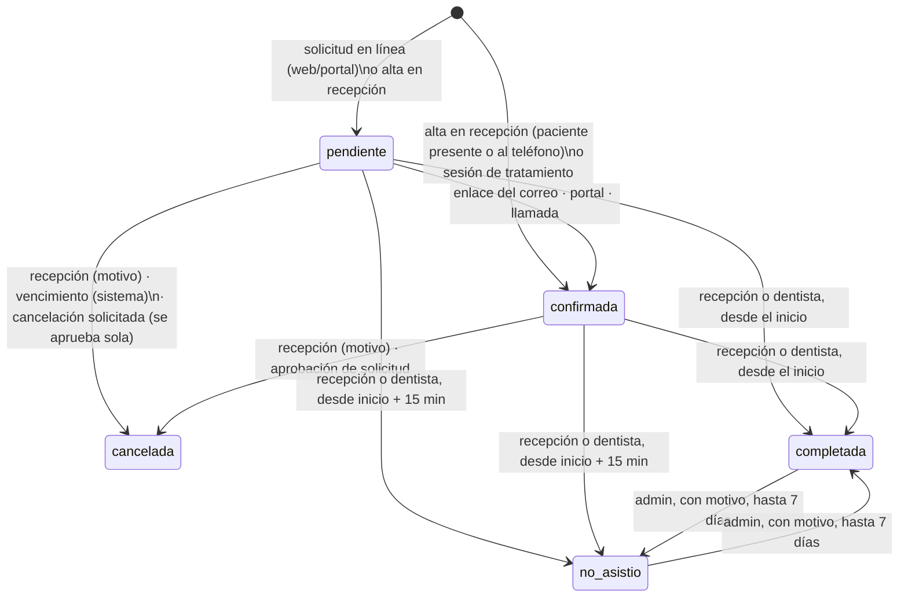

# Diseño de la Fase 2: agenda y citas

> **Estado:** **aprobado con ajustes** (2026-11-23). Las decisiones están en la sección 12.1. La tabla de escenarios (sección 2.5) está aprobada. No se programa hasta que la Fase 1 esté integrada a `main`; entonces esta rama se rebasa sobre `main`.
> **Rama:** `fase-2-agenda` (creada desde `fase-1-base-datos`).
> **Alcance:** toda la lógica de citas del backend y su contrato de API. El panel React no se toca (el panel nuevo es la Fase 3). El sitio y el portal (páginas) son de otra etapa; aquí solo se diseña su API.
> **Base:** `CLAUDE.md`, `docs/database/modelo-datos.md`, `docs/fase-1-informe.md`, `docs/requirements/requerimientos.md`.

---

## 0. Punto de partida (lo que ya existe tras la Fase 1)

| Pieza | Estado | Qué cambia en la Fase 2 |
|---|---|---|
| `citas` con `inicio`/`fin` UTC y restricción `citas_sin_traslape_dentista` | Hecho | Se conserva como autoridad final. |
| `configuracion_agenda`, `horario_dias`, `horario_descansos`, `agenda_cierres` | Hecho; sembrado 8–16, descansos 11–12 y 14–15 | Columnas nuevas en minutos (1.6); la migración convierte la fila sembrada. |
| `AgendaService.HorariosDelDiaAsync` / `HorariosDisponiblesAsync` | Simplificado | Se sustituye por el reloj de atención (2.3) y el motor de disponibilidad (sección 1). |
| `CitasController` (`POST`, `PUT`, `PATCH confirmar`, `PATCH cancelar`) | Hecho; lo usa `citas.jsx` | Acciones por transición (sección 9). `PUT` y `horarios-disponibles` se conservan como compatibilidad hasta la Fase 3 (no se borran). |
| `CitasRepository.GuardarAsync` reintenta 40P01 en el mismo contexto | Hecho | Reintenta en contexto y transacción nuevos (6.3). |
| `cita_historial` con trigger de solo inserción | Hecho en `Inicial` | El commit 1 agrega el trigger de `citas` y prueba ambos. |
| `cita_historial.detalle` guarda el motivo de cancelación | Hecho en la Fase 1 | Pasa a texto genérico; el motivo queda solo en `citas` y se marca sensible (decisión 11). |
| `notificaciones` | Solo la tabla | Bandeja de salida (sección 7). |
| `citas.confirmacion_token_hash` / `_expira_en` | Sin uso | Quedan sin uso y **no se borran**; los tokens van en `cita_tokens` (decisión 12). |

---

## 1. Disponibilidad

### 1.1 Principios

1. **Toda regla de horario se evalúa en hora local de la clínica** (`Clinica:ZonaHoraria`, IANA `America/Mexico_City`) y **todo instante se guarda en UTC**. Nunca se usa un desplazamiento fijo: la conversión pasa por la zona IANA en el único servicio de conversión (`IRelojClinica`).
2. **Un solo motor de disponibilidad** (`IDisponibilidadService`) para el sitio, el portal, el panel y la validación de cada reserva. La reserva **vuelve a calcular** dentro de su transacción; lo que mostró la pantalla es orientativo.
3. **"Ahora" viene de `TimeProvider`**, no de `now()` en SQL: las pruebas controlan el reloj y la aplicación y la base no discrepan. `creado_en` de las citas también se toma de `TimeProvider` (hoy el contexto usa `DateTime.UtcNow`; se ajusta).
4. La restricción de exclusión de la base sigue siendo la última barrera contra el traslape.

### 1.2 Entradas y salidas

```
Calcular(rango de fechas locales, servicioId, canal, dentistaId?) →
    lista de { inicioLocal, inicioUtc, finUtc, dentistasLibres[] }
```

- **`canal`:** `en_linea` (sitio y portal) o `recepcion` (asistente y admin). Determina la anticipación (1.5).
- **`dentistaId`:** solo lo envían asistente o admin. Los canales en línea nunca lo reciben ni lo ven.
- **Respuesta pública:** solo horas; `dentistasLibres` nunca sale por un endpoint público.

### 1.3 Algoritmo (por fecha local)

1. **Día laborable** según `horario_dias` (ISO: 1 lunes … 7 domingo). Si no lo es, no hay horarios.
2. **Cierres:** un `agenda_cierres` de todo el día deja la fecha sin horarios. Los cierres parciales se tratan como descansos de ese día.
3. **Horarios base:** desde `hora_apertura`, en pasos de `duracion_slot_minutos`, mientras `t + slot ≤ hora_cierre`.
4. **Bloques no disponibles** = descansos (de todos los días o de ese día) + cierres parciales.
5. **Espacios consecutivos.** Un servicio de `n = duracion_slots` necesita `[t, t + n × slot)`:
   - debe terminar a más tardar al cierre;
   - **no puede cruzar ningún descanso ni cierre**.
   Con la configuración sembrada, los inicios para 1 espacio son 8, 9, 10, 12, 13 y 15; para 2 espacios, 8, 9 y 12.
6. **Conversión a UTC** con `IRelojClinica`:
   - una hora local inexistente (salto de horario de verano) se omite;
   - una hora ambigua toma la primera ocurrencia.
7. **Anticipación y horizonte (1.5):**
   - en línea: `AtencionEntre(ahora, inicio) ≥ anticipación en línea` (horas de atención, sección 2);
   - recepción: `inicio − ahora ≥ anticipación de recepción` (minutos de reloj);
   - siempre `inicio > ahora`;
   - fecha local `≤ hoy + horizonte_reserva_dias`.
8. **Dentistas elegibles:** activos, no eliminados y ligados al servicio en `dentista_servicios`. **Si el servicio no tiene ningún dentista ligado, lo puede atender cualquier dentista activo** (decisión 4). En ese caso se crea una notificación interna a los administradores, sin duplicar: una sin leer por servicio.
9. **Ocupación.** Bloquean las citas que se traslapan con el intervalo y que están:
   - `confirmada`, o
   - `pendiente` con `bloqueo_expira_en IS NULL` (recepción) o `> ahora`.
   Las pendientes vencidas no bloquean: la reserva las cancela en su transacción (6.1).
10. **Resultado:** el horario está disponible si queda al menos un dentista elegible libre en todo el intervalo.

### 1.4 Consultas y rendimiento

- Una consulta por rango con el índice `(dentista_id, inicio)`; el resto, en memoria.
- La disponibilidad pública acepta como máximo 14 días por consulta (configurable).
- Sin caché en esta fase.

### 1.5 Anticipación (decisiones 2 y sección 2)

| Canal | Regla | Valor por defecto | Unidad |
|---|---|---|---|
| En línea (sitio, portal) | `AtencionEntre(ahora, inicio) ≥ anticipacion_en_linea_atencion_minutos` | 180 (3 h) | **Minutos de atención** |
| Recepción | `inicio − ahora ≥ anticipacion_recepcion_minutos` | 60 | **Minutos de reloj** |
| Ambos | `inicio > ahora` (nunca en el pasado) | — | — |
| Recepción con **paciente presente** (indicador `pacientePresente`, solo admin y asistente; decisión del dueño, 2026-11-24) | Sin anticipación mínima. Inicio pasado solo si `AtencionEntre(inicio, ahora) ≤ 15`. Horizonte igual. Sin vencimiento. | 15 (`ReglaBloqueo.ToleranciaPacientePresenteMinutos`) | **Minutos de atención** |

**Paciente presente:** el indicador queda en la cita (`citas.paciente_presente`), en su historial (`datos.pacientePresente`) y en la bitácora (alta). Sin él, todo sigue igual. El público y el paciente no pueden enviarlo: `POST /api/citas` es solo de recepción, y los endpoints públicos y del portal no lo aceptan. El panel lo usará en el bloque (f).

**Con menos anticipación de la permitida en línea:**
- el sitio no ofrece el horario y muestra que se llame;
- la asistente agenda directo, con la regla de recepción.

### 1.6 Cambios de esquema (migración nueva, commit 2)

`configuracion_agenda`:

| Columna nueva | Default | Restricción | Sustituye a |
|---|---|---|---|
| `anticipacion_en_linea_atencion_minutos smallint` | 180 | `> liberacion_antes_cita_atencion_minutos` | `anticipacion_minima_horas` |
| `anticipacion_recepcion_minutos smallint` | 60 | `>= 0` | — |
| `liberacion_antes_cita_atencion_minutos smallint` | 120 | `> 0` | `liberacion_antes_cita_horas` |
| `vida_maxima_solicitud_atencion_minutos smallint` | 720 | `> 0` | `bloqueo_pendiente_horas` |
| `horizonte_reserva_dias smallint` | 60 | `> 0` | — |

- La migración **ajusta la fila sembrada** a estos valores (decisión 3). Las tres columnas sustituidas se renombran y convierten en la misma migración. Son parámetros de configuración, no datos ni funcionalidad. `DatosInicialesService` usa los defaults nuevos.
- **Por qué la restricción `anticipación en línea > liberación`:** garantiza que toda solicitud en línea tenga al menos `anticipación − liberación` (hoy 1 h) de atención para confirmarse.
- `citas`: `CHECK (bloqueo_expira_en IS NULL OR bloqueo_expira_en > creado_en)`, como respaldo en la base.

---

## 2. Bloqueo de solicitudes pendientes (decisión: regla E + A + D)

### 2.1 Problema que resuelve (resumen)

La regla anterior, `min(creado + 24 h, inicio − 2 h)` en horas de reloj, fallaba en dos casos:
- **Solicitudes de último momento:** con poca antelación nacían vencidas.
- **Solicitudes nocturnas o de fin de semana:** vencían sin que recepción abriera; por ejemplo, la del sábado a las 20:00 para el lunes vencía el domingo.

La regla aprobada mide todo en **horas de atención**.

### 2.2 Horas de atención

**Tiempo de atención** de un día laborable = intervalo de apertura a cierre, menos descansos y menos cierres (totales o parciales) de esa fecha. Los días no laborables y los cierres de día completo aportan cero. Con la configuración sembrada, cada día de lunes a sábado aporta 6 h: 8–11, 12–14 y 15–16.

Tres operaciones, todas en hora local de la clínica y con resultado convertido a UTC:

| Operación | Definición | Convención en los límites |
|---|---|---|
| `AtencionEntre(a, b)` | Minutos de atención dentro de `[a, b)`. | — |
| `SumarAtencion(t, m)` | El **primer** instante `t' ≥ t` con `AtencionEntre(t, t') = m`. | Si `m` se completa justo al cerrar un tramo, el resultado es ese cierre (p. ej., 8:00 + 3 h = 11:00, no 12:00). |
| `RestarAtencion(t, m)` | El **último** instante `t' ≤ t` con `AtencionEntre(t', t) = m`. | Si varios instantes cumplen (porque hay un descanso en medio), se toma el más cercano a `t` (p. ej., 15:00 − 2 h = 12:00, no 11:00). |

Las dos convenciones hacen que la solicitud **venza lo antes posible** dentro de la regla, para no bloquear el horario más de lo necesario. Ambas operaciones tienen un tope de búsqueda de 366 días: una configuración sin días laborables produce un error controlado, nunca un ciclo infinito.

### 2.3 Fórmula

Solo para origen `web` o `portal` (recepción: `bloqueo_expira_en = NULL`):

```
aceptada         ⇔ AtencionEntre(creado, inicio) ≥ anticipacion_en_linea          (3 h de atención)
bloqueo_expira_en = min( SumarAtencion(creado, vida_maxima),                       (12 h de atención)
                         RestarAtencion(inicio, liberacion_antes_cita) )           (2 h de atención)
```

**Propiedades garantizadas:**
- `bloqueo_expira_en > creado`.
- La ventana de confirmación es de al menos `anticipación − liberación` = 1 h de atención.
- La ventana nunca pasa de 12 h de atención.

### 2.4 Implementación

- **`ICalendarioAtencion`:** construye, para un rango de fechas, los tramos de atención a partir de `configuracion_agenda`, `horario_dias`, `horario_descansos` y `agenda_cierres`. Es el único que lee la base.
- **`RelojAtencion`:** clase pura, sin base ni reloj del sistema. Implementa `AtencionEntre`, `SumarAtencion` y `RestarAtencion` sobre una lista de tramos.
- **`CalcularBloqueo(creado, inicio, canal, tramos, parámetros) → Rechazada(motivo) | Aceptada(bloqueoExpiraEn?)`:** función pura. Es el único punto donde vive la regla; el motor de disponibilidad y la reserva la usan.
- **Pruebas:** la tabla 2.5 completa como prueba parametrizada de la función pura, y otra vez de punta a punta con la base (Testcontainers) en el commit de reservas.

### 2.5 Escenarios resueltos

**Supuestos de la tabla:**
- Configuración sembrada (lunes a sábado 8–16, descansos 11–12 y 14–15).
- Parámetros: anticipación en línea 3 h de atención, liberación 2 h, vida máxima 12 h, recepción 60 min de reloj, horizonte 60 días.
- Calendario: el lunes es 30-nov-2026.
- Los cierres se indican en cada fila.
- "Vida" = `SumarAtencion(creado, 12 h)`; "Liberación" = `RestarAtencion(inicio, 2 h)`.

| # | Solicitud (creado) | Cita (inicio) | Canal y cierres | Atención entre ambos | Resultado | Vida | Liberación | **Vence** | Ventana para confirmar |
|---|---|---|---|---|---|---|---|---|---|
| 1 | sáb 28-nov 20:00 | lun 30-nov 08:00 | En línea | 0 h | **Rechazada**: el sitio indica que se llame | — | — | — | — |
| 2 | sáb 28-nov 20:00 | lun 30-nov 12:00 | En línea | 3 h (lun 8–11) | **Aceptada** | mar 1-dic 16:00 | lun 30-nov 09:00 | **lun 30-nov 09:00** | 1 h (lun 8–9) |
| 3 | mar 1-dic 08:00 | mar 1-dic 15:00 | En línea | 5 h | **Aceptada** | mié 2-dic 16:00 | mar 1-dic 12:00 | **mar 1-dic 12:00** | 3 h |
| 4 | mar 1-dic 08:00 | mar 1-dic 10:00 | En línea | 2 h | **Rechazada** (recepción sí puede: 120 min de reloj ≥ 60) | — | — | — | — |
| 5 | mar 1-dic 09:00 | mar 1-dic 13:00 | En línea; límite exacto | 3 h (9–11, 12–13) | **Aceptada** (`≥`) | jue 3-dic 09:00 | mar 1-dic 10:00 | **mar 1-dic 10:00** | 1 h |
| 6 | mar 1-dic 11:30 (en descanso) | mar 1-dic 15:00 | En línea | 2 h (12–14) | **Rechazada** | — | — | — | — |
| 7 | sáb 5-dic 09:00 | lun 7-dic 10:00 | En línea; **cruza el domingo** | 7 h (sáb 5 + lun 2) | **Aceptada** | mar 8-dic 09:00 | lun 7-dic 08:00 | **lun 7-dic 08:00** | 5 h (todo el sábado) |
| 8 | vie 4-dic 15:30 | lun 7-dic 09:00 | En línea; **cruza el domingo** | 7.5 h | **Aceptada** | lun 7-dic 15:30 | sáb 5-dic 15:00 | **sáb 5-dic 15:00** | 5.5 h |
| 9 | lun 30-nov 08:00 | lun 14-dic 08:00 | En línea; manda la vida máxima | 72 h (12 días laborables × 6 h) | **Aceptada** | mar 1-dic 16:00 | sáb 12-dic 13:00 | **mar 1-dic 16:00** | 12 h |
| 10 | jue 24-dic 10:00 | sáb 26-dic 10:00 | En línea; **cierre de todo el día vie 25-dic** | 6 h (jue 4 + vie 0 + sáb 2) | **Aceptada** | lun 28-dic 10:00 | sáb 26-dic 08:00 | **sáb 26-dic 08:00** | 4 h (jueves) |
| 11 | jue 24-dic 15:00 | sáb 26-dic 09:00 | En línea; **cierre vie 25-dic** | 2 h (jue 1 + vie 0 + sáb 1) | **Rechazada** (sin el cierre: 8 h y aceptada) | — | — | — | — |
| 12 | mié 2-dic 08:00 | jue 3-dic 09:00 | En línea; **cierre parcial mié 2-dic 12:00–16:00** | 4 h (mié 8–11 + jue 8–9) | **Aceptada** | vie 4-dic 11:00 | mié 2-dic 10:00 | **mié 2-dic 10:00** | 2 h |
| 13 | mar 1-dic 14:00 | mar 1-dic 15:00 | Recepción | 60 min de reloj | **Aceptada**, `bloqueo_expira_en = NULL` | — | — | — | — |
| 14 | mar 1-dic 14:30 | mar 1-dic 15:00 | Recepción | 30 min de reloj | **Rechazada** (menos de 60 min) | — | — | — | — |
| 15 | lun 30-nov 10:00 | mar 2-feb-2027 08:00 | Cualquiera | — | **Rechazada** por horizonte (límite: 29-ene-2027) | — | — | — | — |

**Verificación de los tres casos pedidos:** los tres coinciden con lo esperado.
- Caso 1: sábado 20:00 → lunes 8:00, rechazada.
- Caso 2: sábado 20:00 → lunes 12:00, aceptada y vence el lunes a las 9:00.
- Caso 3: martes 8:00 → martes 15:00, aceptada y vence el martes a las 12:00. Este caso exige la convención de "último instante" al restar (2.2): entre las 11:00 y las 12:00 cualquier instante tiene 2 h de atención antes de las 15:00; la regla toma las 12:00.

**Observaciones de los escenarios (no contradicen lo aprobado, pero conviene que las veas):**
- **Filas 7 y 10, vencimiento justo a la hora de apertura** (lunes 8:00; sábado 8:00). La ventana de confirmación ocurrió en días anteriores. Si nadie confirmó, el paciente recibe el aviso de vencimiento al abrir la clínica, 2 h antes de la cita, y recepción ya no puede rescatarla con la regla automática. Sí puede confirmarla a mano mientras el barrido no la haya cancelado y el horario siga libre (4.2).
- **Fila 8:** una cita del lunes 9:00 solicitada el viernes por la tarde se libera el sábado a las 15:00, antes del fin de semana. Es coherente con la regla.
- **Fila 9:** con mucha antelación manda la vida máxima: 12 h de atención equivalen a unos dos días laborables.

---

## 3. Asignación de dentista

### 3.1 Regla general

El paciente nunca elige al dentista. La asignación ocurre **dentro de la transacción de la reserva**, entre los dentistas elegibles y libres (1.3, pasos 8 y 9).

### 3.2 Un solo dentista activo

Se asigna automáticamente. Si no está libre, el horario no se ofrece.

### 3.3 Varios dentistas (decisión 5)

Orden determinista:
1. **Continuidad:** el dentista elegible y libre con quien el paciente ya tiene citas (completadas, confirmadas o pendientes). Solo para pacientes identificados.
2. **Menor carga del día** (citas activas en la fecha local).
3. **Menor carga de la semana.**
4. **Desempate:** `id` menor.

### 3.4 Reasignación por la asistente

- **Acción:** `PATCH /api/citas/{id}/dentista` con el dentista nuevo y un motivo.
- **Quién:** asistente o admin.
- **Estados:** pendiente o confirmada.
- **Validación:** mismo horario; el motor (dentista nuevo elegible y libre) y la restricción de la base.
- **Historial:** acción nueva `reasignacion` (migración del `CHECK`); bitácora con el antes y el después.
- **Sin correo al paciente** (decisión 14).

**Visibilidad del dentista (decisión 5):**
- Los correos **no** muestran el nombre del dentista.
- El portal lo muestra solo en citas **confirmadas**.

### 3.5 Baja de un dentista

Las citas futuras activas de un dentista desactivado o eliminado no se reasignan solas: `GET /api/citas?dentistaInactivo=true` las lista para la asistente.

---

## 4. Flujo de la cita: estados y transiciones

### 4.1 Diagrama



### 4.2 Transiciones válidas

| Desde | Hacia | Quién | Canal en historial | Condiciones |
|---|---|---|---|---|
| — | pendiente | Anónimo (sitio), paciente (portal) | `web` / `portal` | `CalcularBloqueo` aceptada (sección 2); tope por contacto (8.2); CAPTCHA (8.3). |
| — | pendiente | Asistente, admin | `panel` | Regla de recepción; `bloqueo_expira_en = NULL`. |
| — | confirmada | Asistente, admin | `llamada` / `panel` | `confirmarAlCrear: true` (decisión 6). Las sesiones siguientes de un tratamiento se crean así (decisión 9). |
| pendiente | confirmada | Paciente con el enlace del correo | `correo` | Token válido; no vencida. |
| pendiente | confirmada | Paciente (portal) | `portal` | Cita propia; no vencida. |
| pendiente | confirmada | Asistente, admin | `llamada` | Incluso **vencida pero aún no cancelada**, si el horario sigue libre; limpia `bloqueo_expira_en`. |
| pendiente / confirmada | cancelada | Asistente, admin | `panel` / `llamada` | Motivo obligatorio (RN-02). |
| pendiente | cancelada | Sistema | `sistema` | Vencimiento (sección 6); aviso al paciente (decisión 14). |
| pendiente | cancelada | Paciente (portal o enlace) | `portal` / `correo` | **Cancelación solicitada sobre una pendiente: se aprueba sola** (decisión 10). |
| confirmada | cancelada | Asistente, admin al aprobar la solicitud | `llamada` | 4.4. |
| pendiente / confirmada | mismo estado, otro horario | Asistente, admin | `panel` / `llamada` | Reagenda (4.5). |
| pendiente / confirmada | completada | Asistente, admin; dentista en sus citas | `panel` | `ahora ≥ inicio` (decisión 7). |
| pendiente / confirmada | no_asistio | Asistente, admin; dentista en sus citas | `panel` | `ahora ≥ inicio + 15 min` (decisión 7). |
| completada ↔ no_asistio | — | **Solo admin** | `panel` | Motivo obligatorio; hasta 7 días después del inicio (decisión 7). |
| cancelada | cualquiera | Nadie | — | Final. Reabrir una cancelada sería ocupar de nuevo un horario que pudo tomar otra persona: se crea una cita nueva. |

- **Una sola clase `TransicionesCita`** valida; los controladores no repiten reglas.
- **Transición inválida:** `409 TRANSICION_INVALIDA` con mensaje en español.
- **Concurrencia optimista** con la columna de sistema `xmin` (sin cambio de esquema): `409 CITA_MODIFICADA` ("La cita cambió mientras la editabas; recarga").

### 4.3 Solicitud desde invitado o paciente con cuenta

**Invitado (sitio):**
- **Datos:** nombre, apellido, correo o teléfono (al menos uno), servicio, fecha, hora, motivo opcional, aceptación del aviso de privacidad, token de Turnstile y campo trampa.
- **Motivo:** como máximo **300 caracteres**. El formulario muestra: *"Describe brevemente el motivo de tu visita. Por favor no escribas datos médicos ni diagnósticos; los revisaremos en tu consulta."*
- **Nunca se busca un paciente existente:** siempre se crea un `pacientes` nuevo (`origen = web`, `contacto_verificado = false`). No hay enumeración, y nadie puede agregar citas al expediente de otra persona.
- La fusión de duplicados es de una fase posterior (decisión 22).

**Paciente con cuenta (portal):** usa su ficha; el contacto sale de la ficha.

**Transacción:**
1. Candado por fecha (6.1).
2. Liberación de vencidas.
3. `CalcularBloqueo`.
4. Asignación de dentista.
5. Alta de la cita.
6. Historial `creacion`.
7. Bitácora.
8. Notificaciones: correo "solicitud recibida" si hay correo; aviso interno a recepción.

**Respuesta:**
- Pública: `202` genérico.
- Portal: `201` con la cita propia.

### 4.4 Solicitud de reprogramación o cancelación del paciente

- Desde el portal (con cuenta) o desde el enlace de gestión del correo (invitado).
- Llena el indicador (`solicitud_cambio_tipo`, motivo y fecha); la cita conserva su horario y su estado. Una solicitud nueva reemplaza a la anterior y queda en el historial.
- **Cancelación de una pendiente: se aprueba sola**, de inmediato (decisión 10).
- **Resolución por recepción** de una cancelación sobre una cita confirmada o de cualquier reagenda: `POST /api/citas/{id}/solicitud-cambio/resolver`.
  - Aprobar una cancelación → `cancelada`.
  - Aprobar una reagenda → reagenda en la misma operación.
  - Rechazar → limpia el indicador.
  - Historial `solicitud_cambio` / `resolucion_solicitud` y correo al paciente con el resultado.

### 4.5 Reagenda y sesiones siguientes

- **Reagenda** (`PATCH /api/citas/{id}/reagendar`; asistente o admin) con fecha, hora, dentista opcional y motivo.
  - **Por defecto la cita queda confirmada** (decisión 8); recepción puede elegir pendiente.
  - **Conserva el precio original** (decisión 8).
  - Valida con el motor de recepción y libera vencidas en el horario nuevo.
- **Sesiones siguientes de un tratamiento:** cada una es una **cita independiente, creada ya confirmada** (decisión 9), con `POST /api/citas` y `confirmarAlCrear: true`. El enlace a un plan llegará con la columna aditiva `plan_tratamiento_sesion_id` de una fase posterior.

### 4.6 Historial (decisión 11)

- Cada transición escribe `cita_historial` en el mismo `SaveChanges` que el cambio.
- **Canales** con `CHECK`: `panel`, `llamada`, `correo`, `portal`, `web`, `sistema`.
- **Acciones nuevas** en el `CHECK`: `reasignacion`, `vencimiento`, `reenvio_enlace`, `correccion_estado` (migración nueva).
- **`detalle` es siempre un texto genérico** ("Cancelada por recepción", "Solicitud de cambio: cancelar"). **Ningún motivo libre entra en `cita_historial`**, que es inmodificable.
- Los motivos (`citas.motivo`, `motivo_cancelacion`, `solicitud_cambio_motivo`) viven solo en la fila de `citas` y se marcan `[DatoSensible]`: la bitácora registra `"[cambió]"`.
- Esto corrige el comportamiento de la Fase 1, que guardaba el motivo de cancelación en `detalle`. Las filas ya escritas en bases de desarrollo no se pueden modificar (trigger); en producción no hay datos.

---

## 5. Enlaces por correo

### 5.1 Token

- **Generación:** 32 bytes de `RandomNumberGenerator`, codificados en base64url.
- **Almacenamiento:** solo el hash **SHA-256**. El token en claro existe únicamente en el correo y en la memoria del trabajador que lo envía: se genera **al enviar** (7.3), así que la bandeja de salida nunca lo guarda.
- **Un solo uso:** `UPDATE … WHERE token_hash = @h AND usado_en IS NULL AND expira_en > @ahora`, en la transacción del cambio.
- **Vencimiento:**
  - Confirmar: `min(bloqueo_expira_en, inicio)`.
  - Gestionar: hasta el inicio.
- **Reenvío:** invalida los anteriores del mismo propósito.

### 5.2 Tabla `cita_tokens` (decisión 12; migración nueva)

| Columna | Tipo / restricción |
|---|---|
| `id` | `bigint` identity |
| `cita_id` | `int NOT NULL` FK a `citas` |
| `proposito` | `text CHECK IN ('confirmar','gestionar')` |
| `token_hash` | `char(64)` único |
| `expira_en`, `usado_en`, `invalidado_en`, `creado_en` | `timestamptz` |

- Sin borrado físico (trigger, igual que `citas`).
- `citas.confirmacion_token_hash` y `confirmacion_token_expira_en` quedan **sin uso y no se borran**.

### 5.3 Página y endpoints

- El enlace es `{Clinica:UrlPublica}/cita#t={token}`. El token va en el **fragmento**: no viaja al servidor, ni en `Referer`, ni en registros. La página lo envía en el cuerpo de un `POST`.
- **Confirmar requiere un clic**, nunca un `GET`, por los filtros de correo que abren enlaces.
- **Datos que muestra:** servicio, fecha y hora local, estado y nombre de la clínica. Sin nombre del paciente, dentista, motivo ni contacto.
- **Errores que no filtran información:** token alterado, inexistente o vencido → el mismo `404`. Ya confirmada → `200` "Tu cita ya está confirmada".
- **Cabeceras:** `Cache-Control: no-store`, `Referrer-Policy: no-referrer`.
- **Sin página provisional (decisión 13)**, con dos consecuencias:
  - Mientras el sitio (Astro) no exista, `Clinica:UrlPublica` queda vacío. Las plantillas **omiten los enlaces** y dicen "Te llamaremos para confirmar". La confirmación es por llamada.
  - Los tres endpoints de enlaces se construyen y prueban en esta fase, listos para cuando el sitio llegue.

### 5.4 Sin enumeración

- La solicitud pública responde igual exista o no el contacto, y no busca pacientes (4.3).
- El tope por contacto también responde igual (8.2).
- **Registro y alta de usuarios (P9):** se corrige en un **commit aparte** (decisión 18). Las respuestas pasan a ser genéricas, y se avisa por correo al dueño de la cuenta existente cuando alguien intenta registrarla.

---

## 6. Vencimiento de pendientes y reintentos

### 6.1 Liberación dentro de la reserva

En toda transacción que ocupa un horario (alta, reagenda, reasignación):

1. **Candado transaccional por fecha local:** `pg_advisory_xact_lock(clave)`.
   - **Clave:** los primeros 8 bytes (big-endian) del **SHA-256** de `"dentissa:agenda:yyyy-MM-dd"`, interpretados como `bigint`. Es determinista entre procesos, versiones y máquinas; **no se usa `GetHashCode`**, que cambia entre ejecuciones.
   - Con dos fechas (reagenda), en orden ascendente de fecha.
2. Se cancelan las `pendiente` con `bloqueo_expira_en <= ahora` que se traslapan con el intervalo, para los dentistas candidatos. Motivo "Solicitud no confirmada a tiempo", historial `vencimiento` (canal `sistema`), bitácora y aviso al paciente (decisión 14).
3. `CalcularBloqueo` y asignación.
4. Alta o movimiento. La restricción de exclusión queda como respaldo.

### 6.2 Barrido en segundo plano

- `BarridoVencidasService` cada `Agenda:BarridoMinutos` (5).
- Lotes de 100 con `FOR UPDATE SKIP LOCKED`, cada lote en su transacción.
- Candado de sesión `pg_try_advisory_lock` con la clave de `"dentissa:barrido-vencidas"` (mismo esquema de hash), para correr una sola vez aunque haya varias instancias.
- **Carrera con una confirmación:** las dos usan `UPDATE` condicional sobre `estado` y `bloqueo_expira_en`; solo una tiene efecto.

### 6.3 Reintentos acotados

`EjecutarReservaAsync(operación)`:
- Cada intento usa **`DbContext` y transacción nuevos**.
- **Se reintentan:** `40P01` (interbloqueo) y `23P01` (traslape: el reintento recalcula y puede asignar a otro dentista o concluir que no hay lugar).
- **Máximo 3 intentos**, con espera aleatoria de 25–150 ms.
- **Al agotarse**, `409` en español:
  - Público y portal: `HORARIO_NO_DISPONIBLE`, "Ese horario acaba de ocuparse. Elige otro, por favor."
  - Panel: `HORARIO_OCUPADO`, "El dentista ya tiene una cita en ese horario."

---

## 7. Correo

### 7.1 Abstracción y configuración

```csharp
public interface IEmailSender
{
    Task EnviarAsync(MensajeCorreo mensaje, CancellationToken ct); // Para, Asunto, CuerpoTexto, CuerpoHtml
}
```

**Implementaciones:**
- `SmtpEmailSender` (MailKit): en desarrollo apunta a **Mailpit**; en producción, al SMTP del proveedor que se elija antes del primer despliegue (decisión 23).
- `EmailSenderEnMemoria`: para pruebas.

**Configuración:**
- **Secretos** en user-secrets o variables de entorno: `Correo:Smtp:Usuario` y `Correo:Smtp:Password`.
- **Resto:** `Correo:Habilitado`, `Correo:Remitente`, `Correo:NombreRemitente`, `Correo:Smtp:Host`, `Correo:Smtp:Puerto`, `Correo:Smtp:Seguridad`.

**Datos de la clínica en configuración** (decisión 21): `Clinica:Nombre`, `Clinica:Direccion`, `Clinica:Telefono`, `Clinica:WhatsApp` y `Clinica:UrlPublica`.

**docker-compose:** servicio `mailpit` (imagen `axllent/mailpit` con versión fija), en `127.0.0.1:1025` (SMTP) y `127.0.0.1:8025` (bandeja web). Solo para desarrollo.

### 7.2 Plantillas en español

| Plantilla | Cuándo | Contenido |
|---|---|---|
| `solicitud_recibida` | Solicitud en línea | Servicio, fecha y hora; "aún no está confirmada"; enlaces de confirmar y gestionar (si hay `UrlPublica`). |
| `confirmacion` | Al confirmarse | Servicio, fecha, hora, dirección; enlace de gestionar. |
| `recordatorio` | **24 h antes** (decisión 14), solo citas confirmadas | Igual que la confirmación. |
| `cambio` | Reagenda | Horario anterior y nuevo. (Cambio de dentista: **sin correo**.) |
| `cancelacion` | Cancelación por recepción, aprobada o automática por solicitud | Fecha y "si fue un error, llámanos". Sin el motivo. |
| `solicitud_cambio_recibida` | El paciente pidió una reagenda o la cancelación de una confirmada | "Te llamaremos para confirmarlo". |
| `vencimiento` | Al vencer una solicitud (decisión 14) | "Tu solicitud no se confirmó a tiempo; puedes solicitar otro horario o llamarnos". |
| `tope_pendientes` | Tope por contacto alcanzado (8.2) | "Ya tienes solicitudes pendientes; confírmalas o llámanos". |
| `intento_registro` | Registro con un correo ya registrado (5.4) | "Alguien intentó crear una cuenta con tu correo; si fuiste tú, inicia sesión o recupera tu contraseña". |

Ningún correo lleva datos de salud, CURP, motivo ni nombre del dentista.

### 7.3 Bandeja de salida sobre `notificaciones`

- La fila se escribe en la **misma transacción** que el cambio. No guarda cuerpo renderizado ni token, solo la plantilla y sus referencias.
- **Trabajador `EnvioCorreosService`:**
  - Se despierta cada 30 s o al recibir un aviso tras un commit.
  - Reclama lotes con `FOR UPDATE SKIP LOCKED` y un arrendamiento de 10 min.
  - Lee el correo de contacto vigente (`pacientes.correo`), genera el token si hace falta (solo guarda su hash), renderiza y envía.
- **Reintentos:**
  - Esperas de 1 min, 5 min, 15 min, 1 h y 6 h; a la 6.ª falla, `fallida` más un aviso interno a recepción.
  - `error_envio` guarda solo el código o la clase del error.
- **Entrega "al menos una vez":** documentada.
- **Paciente sin correo:** solo se crea un aviso interno.
- **Recordatorios:** `RecordatoriosService` crea cada hora las filas `recordatorio` de las citas confirmadas que empiezan entre 24 y 25 h después, sin duplicar: índice único parcial por `(cita_id, tipo)` para `recordatorio`.

**Migración nueva:**
- `notificaciones`: `estado` (`pendiente`, `procesando`, `enviada`, `fallida`, `descartada`), `intentos`, `proximo_intento_en`, `procesando_desde` y `plantilla`, con índice parcial por `proximo_intento_en` de las pendientes.
- `CHECK` de `tipo` ampliado: `vencimiento`, `reasignacion`, `envio_fallido`, `tope_pendientes`, `intento_registro`, `configuracion`.
- `enviada` y `enviada_en` se conservan por compatibilidad.

---

## 8. Abuso y privacidad

### 8.1 Límites de tasa

Todos configurables; responden `429` con `Retry-After` y mensaje en español.

| Endpoint | Partición | Valor |
|---|---|---|
| `GET /api/publico/disponibilidad` | IP | 60 por minuto |
| `POST /api/publico/citas` | IP | **10 por hora** |
| `POST /api/publico/citas` | Correo normalizado | 3 por día |
| `POST /api/publico/citas` | Teléfono normalizado (dígitos, con lada de México) | 3 por día |
| `/api/publico/enlaces/*` | IP | 20 por 10 minutos |

- **Antes de publicar:** `ForwardedHeaders` con proxies conocidos (P6).
- Con varias instancias, el límite requiere un almacén compartido; queda anotado.

### 8.2 Tope de pendientes por contacto (decisión 15)

- **Regla:** como máximo **2** citas `pendiente` futuras cuyo paciente tenga el mismo correo o teléfono normalizado (`Agenda:MaxPendientesPorContacto`).
- **Teléfonos comparables:** columna generada `pacientes.telefono_normalizado` con índice (migración nueva).
- **Respuesta:** el mismo `202` genérico, no se crea la cita y, si hay correo, se envía `tope_pendientes`.
- **En el portal** (cuenta propia) el tope se informa abiertamente con `409`.

### 8.3 Campo trampa y CAPTCHA (decisión 16)

- **Campo trampa** `sitioWeb`: si llega con valor, `202` genérico, sin crear nada, y un evento `solicitud_descartada` en la bitácora (solo IP y motivo).
- **Cloudflare Turnstile activo desde el primer despliegue**, detrás de `IVerificadorCaptcha`:
  - `TurnstileVerificador`: verifica el token contra el servicio de Cloudflare con la clave secreta de `Captcha:Turnstile:SecretKey` (user-secrets o variable de entorno). Tiempo límite de 5 s.
  - `VerificadorCaptchaDePrueba`: para desarrollo y pruebas, acepta un token fijo de prueba solo en Development y Testing.
  - **Si Cloudflare no responde, la solicitud se rechaza** (falla cerrada) con `503`: "No pudimos verificar la solicitud. Inténtalo de nuevo o llámanos". Es decisión de diseño; la alternativa (aceptar sin verificar) abre la puerta a abuso durante una caída.
  - Turnstile recibe la IP y señales del navegador: debe mencionarse en el aviso de privacidad (revisión legal).

### 8.4 Datos

- Ningún endpoint público devuelve datos de pacientes ni de salud.
- Motivo de la solicitud: máximo 300 caracteres, solo en `citas.motivo` (sensible en la bitácora), nunca en correos ni en el historial.
- La bitácora no lleva valores sensibles ni tokens.
- **Eventos nuevos:** `solicitud_publica`, `solicitud_descartada`, `enlace_invalido` y los cambios de configuración y cierres (decisión 20: todo a bitácora).
- No se registran cuerpos de petición públicos ni tokens en los logs.
- **Aviso de privacidad** (decisión 17, **pendiente de revisión legal**): `pacientes.aviso_privacidad_version` y `aviso_privacidad_aceptado_en` (migración nueva). Se exigen al solicitar en línea y al registrarse.

---

## 9. Endpoints

**Convenciones:**
- **Errores:** `{ "mensaje", "codigo" }` en español; las validaciones van como ProblemDetails con mensajes por campo.
- **Fechas:** `fecha` en `yyyy-MM-dd` y `hora` en `HH:mm`, locales; `inicio` y `fin` en ISO 8601 UTC.
- **Recepción** = Asistente + Admin.

### 9.1 Públicos sin credencial

| Método y ruta | Quién | Cuerpo / consulta | Respuestas |
|---|---|---|---|
| `GET /api/publico/disponibilidad?servicioId&desde&hasta` | Anónimo | Fechas locales; máximo 14 días | `200 [{ fecha, horas: [...] }]`. `400` (servicio inactivo = `400` genérico). `429`. `503 AGENDA_NO_CONFIGURADA`. |
| `POST /api/publico/citas` | Anónimo | `{ nombre, apellido, correo?, telefono?, servicioId, fecha, hora, motivo? (≤300), aceptaAvisoPrivacidad, versionAvisoPrivacidad, captchaToken, sitioWeb }` | `202 { mensaje }` genérico (también con campo trampa o tope). `400` validación, con `ANTICIPACION_INSUFICIENTE` y el texto "Para citas en las próximas horas, llámanos al {Clinica:Telefono}". `409 HORARIO_NO_DISPONIBLE`. `429`. `503 CAPTCHA_NO_DISPONIBLE`. |

### 9.2 Anónimos con token del correo (decisión 19)

| Método y ruta | Cuerpo | Respuestas |
|---|---|---|
| `POST /api/publico/enlaces/consultar` | `{ token }` | `200 { servicio, fecha, hora, estado, acciones }`. `404 ENLACE_INVALIDO`. `429`. |
| `POST /api/publico/enlaces/confirmar` | `{ token }` | `200 { estado: "confirmada" }` (también si ya lo estaba). `404`. `409 CITA_NO_CONFIRMABLE`. `429`. |
| `POST /api/publico/enlaces/solicitar-cambio` | `{ token, tipo, motivo (≤300) }` | `202`; la cancelación de una pendiente se aplica de inmediato. `404`. `409 TRANSICION_INVALIDA`. `429`. |

El catálogo público de servicios llega con el sitio (decisión 19).

### 9.3 Portal del paciente (rol `paciente`)

| Método y ruta | Cuerpo | Respuestas |
|---|---|---|
| `GET /api/portal/citas?estado&desde&hasta` | — | `200` solo propias. Dentista visible solo en confirmadas; sin costos internos. |
| `GET /api/portal/disponibilidad?servicioId&desde&hasta` | — | Igual que la pública. |
| `POST /api/portal/citas` | `{ servicioId, fecha, hora, motivo? }` | `201`. `400`. `409 HORARIO_NO_DISPONIBLE` / `TOPE_PENDIENTES`. |
| `POST /api/portal/citas/{id}/confirmar` | — | `200`. `404` si no es suya. `409`. |
| `POST /api/portal/citas/{id}/solicitud-cambio` | `{ tipo, motivo }` | `202`. `404`. `409`. |

### 9.4 Panel (recepción, dentista, admin)

| Método y ruta | Quién | Cuerpo / consulta | Respuestas principales |
|---|---|---|---|
| `GET /api/citas?desde&hasta&dentistaId&estado&conSolicitud&dentistaInactivo&fueraDeHorario&pagina` | Recepción | — | `200` paginado. |
| `GET /api/citas/{id}` | Recepción | — | `200`, `404`. |
| `GET /api/citas/{id}/historial` | Recepción | — | `200`. |
| `GET /api/citas/mi-agenda?desde&hasta` | Dentista | — | Existente. |
| `GET /api/agenda/disponibilidad?fecha&servicioId&dentistaId?` | Recepción | — | `200 [{ hora, dentistasLibres }]`. |
| `POST /api/citas` | Recepción | `{ pacienteId, servicioId, fecha, hora, dentistaId?, motivo?, costoExtra?, motivoExtra?, confirmarAlCrear? }` | `201`. `400`. `409 HORARIO_OCUPADO`. |
| `PATCH /api/citas/{id}/confirmar` | Recepción | `{ canal }` | `200`. `409`. |
| `PATCH /api/citas/{id}/reagendar` | Recepción | `{ fecha, hora, dentistaId?, motivo, estadoResultante = "confirmada" }` | `200`. `409`. |
| `PATCH /api/citas/{id}/dentista` | Recepción | `{ dentistaId, motivo }` | `200`. `409`. |
| `PATCH /api/citas/{id}/cancelar` | Recepción | `{ motivo }` | Existente, más `409`. |
| `PATCH /api/citas/{id}/completar` | Recepción; dentista (las suyas) | — | `200`. `409` si `ahora < inicio`. `403`/`404` si no es suya. |
| `PATCH /api/citas/{id}/no-asistio` | Recepción; dentista (las suyas) | — | `200`. `409` si `ahora < inicio + 15 min`. |
| `PATCH /api/citas/{id}/corregir-estado` | **Admin** | `{ estado: "completada"\|"no_asistio", motivo }` | `200`. `409` fuera de 7 días o desde un estado no corregible. |
| `PATCH /api/citas/{id}/costos` | Recepción | `{ costoExtra, motivoExtra }` | `200`. |
| `POST /api/citas/{id}/solicitud-cambio/resolver` | Recepción | `{ aprobar, motivo, nuevoHorario? }` | `200`. `409`. |
| `POST /api/citas/{id}/reenviar-enlace` | Recepción | — | `202`. `409` si no es confirmable, no hay correo o no hay `UrlPublica`. |
| `GET /api/notificaciones/internas?noLeidas` · `PATCH /api/notificaciones/{id}/leida` | Recepción (admin además ve avisos de configuración) | — | Bandeja interna. |
| `GET /api/agenda/configuracion` · `PUT /api/agenda/configuracion` | Lectura: recepción. Escritura: admin | Duración, anticipaciones, liberación, vida máxima, horizonte, días, descansos | `200`, `400`. Las citas futuras que queden fuera del horario nuevo se permiten y se listan con `fueraDeHorario=true`; nunca se cancelan solas (decisión 20). |
| `GET /api/agenda/cierres` · `POST` · `DELETE /api/agenda/cierres/{id}` | Admin | `{ fecha, horaInicio?, horaFin?, motivo }` | Al crear, devuelve las citas afectadas, que no se cancelan solas. `DELETE` es físico, permitido para cierres, y queda en la bitácora (decisión 20). |

**Compatibilidad:** `PUT /api/citas/{id}` y `GET /api/citas/horarios-disponibles` se conservan, delegan en los servicios nuevos y se marcan obsoletos. Se retiran con el panel de la Fase 3, previa autorización. El `PUT` valida con `TransicionesCita` (cambio de comportamiento ya avisado).

---

## 10. Plan de pruebas (Testcontainers, PostgreSQL 17)

Reloj controlado (`FakeTimeProvider`) salvo en concurrencia.

| Área | Casos |
|---|---|
| **Reloj de atención** (función pura) | `AtencionEntre`, `SumarAtencion` y `RestarAtencion` con descansos, días no laborables, cierres totales y parciales, y límites de tramo (convenciones de 2.2). Configuración sin días laborables → error controlado. |
| **`CalcularBloqueo`** | **Los 15 escenarios de la tabla 2.5**, parametrizados, como función pura y otra vez de punta a punta con la base. Cada fila comprueba **todas sus columnas**, no solo el resultado: `AtencionEntre(creado, inicio)` (p. ej., 72 h en la fila 9), aceptada o rechazada con su motivo, vida, liberación, `bloqueo_expira_en` y ventana. Así un error en la suma de horas de atención no queda oculto por un resultado correcto. Propiedad: para toda solicitud aceptada, `bloqueo_expira_en > creado` y la ventana está entre 1 h y 12 h de atención (prueba con fechas aleatorias). `CHECK` de la base rechaza `bloqueo_expira_en <= creado_en`. |
| **Disponibilidad** | Lunes → 8, 9, 10, 12, 13, 15. Domingo, cierre total y cierre parcial. Descanso solo de sábado. |
| **Duración múltiple** | 2 espacios → 8, 9, 12. Una cita de 2 espacios ocupa ambos. No cabe en un hueco de 1. |
| **Zona horaria** | Sin desplazamientos fijos. Zona con horario de verano en prueba aislada. Límite de medianoche UTC. |
| **Anticipación y horizonte** | En línea por horas de atención (filas 1–6 de 2.5). Recepción 60 min de reloj (filas 13–14). Nunca en el pasado. Horizonte (fila 15). |
| **Vencimiento** | Una vencida no bloquea. La reserva sobre una vencida la cancela en su transacción (historial `vencimiento` y aviso). El barrido cancela solo vencidas. Carrera barrido frente a confirmación: exactamente una gana. Recepción confirma una vencida aún no cancelada. |
| **Asignación** | Un dentista; varios (continuidad, carga y desempate); servicio sin dentistas → cualquiera, con un solo aviso al admin. Reasignación a un ocupado → `409`; sin correo. |
| **Concurrencia** | 2 solicitudes simultáneas → una `202` y una `409`. 10 simultáneas → una gana y 9 `409`, sin `500`. 2 dentistas y 10 solicitudes → 2 ganan. Reagendas simultáneas. Candado: misma clave para la misma fecha en dos procesos (prueba de la función de hash con valores fijos). Repetición en CI. |
| **Tokens** | Válido. Reuso → "ya confirmada" sin cambios extra. Vencido → `404`. Alterado → `404`. Propósito equivocado → `404`. Reenvío invalida el anterior. El token en claro nunca aparece en la base ni en los logs capturados. |
| **Límites de tasa** | 11.ª por IP en una hora → `429`. 4.ª por correo desde otra IP → `429`. Teléfono con y sin formato. Enlaces. |
| **Abuso** | Campo trampa. Tope de 2 → `202` genérico más correo. Respuesta idéntica exista o no el contacto. CAPTCHA inválido → `400`; Turnstile caído → `503` (servidor simulado). Motivo de 301 caracteres → `400`. |
| **Transiciones** | Cada transición válida de 4.2 y las inválidas. `no_asistio` antes de 15 min → `409`. Dentista sobre una cita ajena → `404`. Corrección del admin dentro y fuera de 7 días. Asistente intentando corregir → `403`. Concurrencia optimista. |
| **Solicitudes de cambio** | Cancelación de una pendiente aprobada al instante. Confirmada: indicador sin mover la cita; aprobación y rechazo. |
| **Historial y privacidad** | Una fila por transición con acción y canal correctos. Ningún motivo libre en `cita_historial`. Motivos como `"[cambió]"` en la bitácora. `citas` y `cita_tokens` sin `DELETE` ni `TRUNCATE`; `cita_historial` sin `UPDATE`, `DELETE` ni `TRUNCATE`. |
| **Correo** | Bandeja en la misma transacción. Reintentos y `fallida` con aviso interno. Sin correo → aviso interno. Sin `UrlPublica` → plantillas sin enlace. Recordatorio único a las 24 h. Ninguna plantilla con motivo, salud ni dentista. Integración con contenedor de Mailpit. |
| **Autorización** | Matriz de todos los endpoints con los 4 roles y anónimo. |
| **Compatibilidad** | `PUT` y `horarios-disponibles` siguen sirviendo al panel actual. |

---

## 11. Plan de commits

Rama `fase-2-agenda`, **rebasada sobre `main` antes del commit 1**. Cada commit compila y pasa las pruebas. Los cambios de esquema son **migraciones nuevas**.

| # | Commit | Contenido |
|---|---|---|
| 1 | `feat(db): citas sin borrado físico` | Migración nueva: trigger `BEFORE DELETE` y `BEFORE TRUNCATE` en `citas`. Pruebas: `citas` rechaza `DELETE` y `TRUNCATE`; `cita_historial` sigue rechazando `UPDATE`, `DELETE` y `TRUNCATE` (regresión). **En el mismo commit:** quitar de `CLAUDE.md` (sección 5) la aclaración entre paréntesis de que «el trigger de `citas` es el primer commit de la Fase 2», porque desde ese momento la base ya lo impide. |
| 2 | `feat(db): configuración de agenda en horas de atención` | Migración 1.6 (columnas en minutos, renombre y conversión, fila sembrada ajustada, `CHECK` de anticipación > liberación, `CHECK bloqueo_expira_en > creado_en`); `DatosInicialesService`; `creado_en` desde `TimeProvider`. |
| 3 | `feat(agenda): reloj de atención y CalcularBloqueo` | `ICalendarioAtencion`, `RelojAtencion` y `CalcularBloqueo` (sección 2), con las pruebas de la tabla 2.5 como función pura y la prueba de propiedades. Sin endpoints. |
| 4 | `feat(agenda): motor de disponibilidad` | `IDisponibilidadService` (sección 1) sobre el reloj de atención; aviso al admin por servicio sin dentistas. Pruebas de disponibilidad, duración, zona horaria, anticipación y horizonte. |
| 5 | `feat(agenda): endpoints de disponibilidad` | Público y de recepción; `horarios-disponibles` delega (compatibilidad). |
| 6 | `feat(agenda): reservas con candado, liberación y reintentos` | `EjecutarReservaAsync`, candado con clave SHA-256 → `bigint`, liberación de vencidas, reintentos en contexto nuevo; `POST /api/citas` del panel lo usa. Escenarios 2.5 de punta a punta. Concurrencia 2 y 10. |
| 7 | `feat(agenda): transiciones de estado e historial` | `TransicionesCita`, `xmin`, `confirmar`, `cancelar`, `completar`, `no-asistio`, `corregir-estado`, `reagendar`, `costos`, `confirmarAlCrear`; `PUT` compatible; historial genérico con motivos sensibles; migración de los `CHECK` de acciones y canales. |
| 8 | `feat(agenda): asignación y reasignación de dentista` | Sección 3. |
| 9 | `feat(db): tokens de cita` | Migración `cita_tokens` (con trigger sin borrado) y `TokensCitaService`. |
| 10 | `feat(correo): bandeja de salida y envío` | Migración de `notificaciones`, `IEmailSender`, MailKit, plantillas, `EnvioCorreosService`, datos de la clínica, Mailpit en `docker-compose.yml`. |
| 11 | `feat(agenda): solicitud pública` | `POST /api/publico/citas`, campo trampa, `IVerificadorCaptcha` con Turnstile, aviso de privacidad y teléfono normalizado (migración), tope por contacto, límites de tasa. |
| 12 | `feat(agenda): enlaces del correo` | Los tres endpoints de 9.2. |
| 13 | `feat(agenda): portal del paciente` | 9.3. |
| 14 | `feat(agenda): solicitudes de cambio` | Resolución por recepción y autoaprobación de la cancelación de pendientes. |
| 15 | `feat(agenda): barrido de vencidas` | `BarridoVencidasService` y pruebas de carrera. |
| 16 | `feat(agenda): recordatorios` | `RecordatoriosService` (24 h). |
| 17 | `feat(agenda): configuración y cierres` | Endpoints de administración, `fueraDeHorario`, bitácora. |
| 18 | `feat(agenda): bandeja interna` | Notificaciones internas. |
| 19 | `fix(seguridad): sin enumeración de correos` | Commit aparte (decisión 18). |
| 20 | `docs: informe de la Fase 2` | Resultados reales, acciones manuales (proveedor SMTP, SPF/DKIM/DMARC, claves de Turnstile, Mailpit) y riesgos. |

Punto de revisión intermedia sugerido: después del commit 7.

---

## 12. Decisiones y riesgos

### 12.1 Decisiones tomadas (2026-11-23)

| # | Tema | Decisión |
|---|---|---|
| 1 | Bloqueo de pendientes | Regla **E + A + D** en horas de atención (sección 2): anticipación en línea de 3 h de atención; liberación de 2 h de atención; vida máxima de 12 h de atención; `bloqueo_expira_en = min(creado + 12 h, inicio − 2 h)`, solo web y portal; con menos anticipación, el sitio pide llamar y la asistente agenda; `CHECK bloqueo_expira_en > creado_en`; función pura `CalcularBloqueo` y reloj de atención con pruebas. |
| 2 | Anticipación de recepción | 60 min de reloj (configurable); nunca en el pasado. |
| 3 | Horizonte | 60 días; la migración ajusta la fila sembrada. |
| 4 | Servicio sin dentistas ligados | Lo atiende cualquier dentista activo, con aviso al admin. |
| 5 | Asignación y visibilidad | Criterio de 3.3; correos sin nombre del dentista; el portal lo muestra en citas confirmadas; sin correo por reasignación. |
| 6 | Citas confirmadas desde recepción | Sí (`confirmarAlCrear`). |
| 7 | Dentista y estados finales | El dentista marca `completada` y `no_asistio` en sus citas (`no_asistio` desde inicio + 15 min). El admin corrige estados finales con motivo, dentro de 7 días (interpretado como `completada` ↔ `no_asistio`; una cancelada no se reabre, ver 4.2). |
| 8 | Reagenda | Confirmada por defecto; conserva el precio original. |
| 9 | Sesiones de tratamiento | Cada sesión es una cita independiente, creada confirmada. |
| 10 | Cancelación solicitada de una pendiente | Se aprueba sola. |
| 11 | Historial | Texto genérico; el motivo sensible solo en la cita. |
| 12 | Tokens | Tabla `cita_tokens`; las columnas viejas quedan sin uso y no se borran. |
| 13 | Página provisional | No. Sin `UrlPublica`, los correos omiten los enlaces (5.3). |
| 14 | Avisos al paciente | Recordatorio 24 h antes y aviso de vencimiento: sí. Cambio de dentista: no. |
| 15 | Tope por contacto | 2 pendientes; respuesta genérica más correo. |
| 16 | CAPTCHA | Turnstile activo desde el primer despliegue, tras `IVerificadorCaptcha`. |
| 17 | Aviso de privacidad | Versión y fecha de aceptación en `pacientes` (pendiente de revisión legal). |
| 18 | Enumeración de correos | Se corrige en un commit aparte. |
| 19 | Endpoints públicos | Los tres de enlaces, sí; el catálogo público, con el sitio. |
| 20 | Cambios de horario y cierres | Lo propuesto (citas fuera de horario se listan y no se cancelan; `DELETE` físico de cierres); todo a bitácora. |
| 21 | Datos de la clínica | En configuración. |
| 22 | Fusión de duplicados | Fase posterior. |
| 23 | Proveedor de correo | Se decide antes del primer despliegue. |
| — | Ajustes | Motivo de máximo 300 caracteres con el texto del formulario (4.3); límite de 10 por hora por IP en `POST /api/publico/citas`; clave del candado con hash determinista SHA-256 → `bigint`; commit propio del reloj de atención y `CalcularBloqueo` antes de la disponibilidad (plan renumerado). |

**Tabla de escenarios (2.5): aprobada**, con la corrección de la fila 9 (72 h de atención). Se confirman además dos interpretaciones: la corrección de estados finales es solo `completada` ↔ `no_asistio`, y los correos van sin enlace hasta que exista el sitio. El commit 1 empieza cuando la Fase 1 esté integrada a `main` y esta rama se rebase.

### 12.2 Riesgos

| Riesgo | Mitigación |
|---|---|
| Solicitudes que vencen a la hora de apertura (filas 7 y 10 de 2.5) | Recepción puede confirmar una vencida mientras no se haya cancelado y el horario siga libre; aviso de vencimiento al paciente. |
| Correos sin enlace hasta que exista el sitio | Confirmación por llamada (flujo ya previsto); los endpoints de enlace quedan listos. |
| Correos marcados como spam | SPF, DKIM y DMARC (acción manual); reintentos y aviso interno al fallar. |
| Filtros de correo que abren enlaces | Confirmar exige un `POST` con clic. |
| Token filtrado | Un solo uso, vencimiento, datos mínimos, sin salud. |
| Turnstile no disponible | Falla cerrada con mensaje para llamar; la recepción no se ve afectada. |
| Solicitudes falsas | Turnstile, límite de tasa, tope por contacto, campo trampa y vencimiento. |
| Pacientes duplicados por invitados | Decisión consciente; fusión en una fase posterior. |
| Límite de tasa en memoria y detrás de un proxy | `ForwardedHeaders` (P6); almacén compartido si hay varias instancias. |
| Diferencia de reloj aplicación–base | Todo "ahora" desde `TimeProvider`; NTP en producción. |
| Cambios de horario de verano | Zona IANA; `tzdata` actualizado en Linux. |
| Interbloqueos al reservar | Candado por fecha, exclusión de respaldo, reintentos acotados y pruebas repetidas. |
| Cambio de comportamiento del `PUT` actual | Avisado; valida transiciones. |
| Filas de historial de la Fase 1 con motivos libres | Solo en bases de desarrollo (inmodificables por trigger); producción no tiene datos. |
| Aviso de privacidad y Turnstile | Revisión legal antes del despliegue. |
| La Fase 1 aún no está en `main` | Rebase antes del commit 1; si su revisión cambia el esquema, se ajusta este diseño. |
