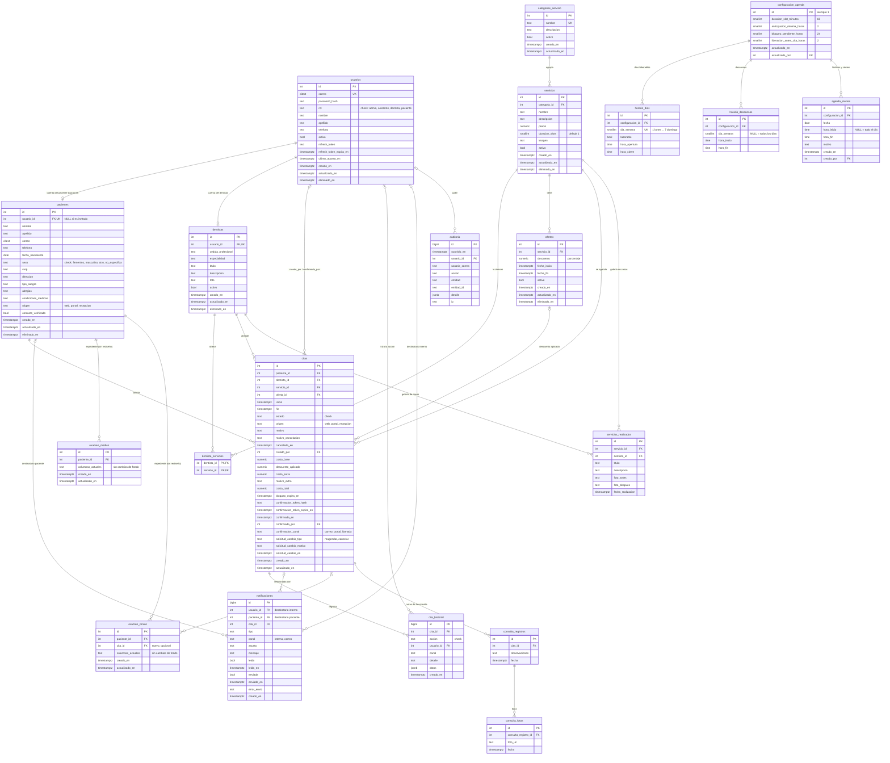

# Modelo de datos — Fase 1 (propuesta)

> **Estado:** propuesta en revisión del arquitecto. Las preguntas abiertas ya están respondidas (sección 8). Nada de esto está implementado todavía.
> **Fecha:** 2026-11-18 · **Rama:** `fase-1-base-datos`
> **Base de datos destino:** PostgreSQL 17 · **Backend:** .NET 10 LTS, EF Core 10 con Npgsql

Este documento describe el modelo que sustituye al esquema actual de SQL Server (scaffold de `backend/Entities/DentissaDbContext.cs`). La lógica de disponibilidad de agenda, el expediente clínico, el inventario y los pagos **no** forman parte de esta fase; aquí solo se deja el cimiento.

---

## 1. Diagrama entidad-relación



---

## 2. Convenciones generales

| Tema | Decisión |
|---|---|
| Nombres | Tablas y columnas en `snake_case` y en español. Se aplica con el paquete `EFCore.NamingConventions` (`UseSnakeCaseNamingConvention()`), así las clases de C# conservan `PascalCase`. |
| Claves | `int` con `GENERATED BY DEFAULT AS IDENTITY`. `bigint` en tablas que crecen mucho (`auditoria`, `cita_historial`, `notificaciones`). Las tablas puente usan clave compuesta. |
| Fechas y horas | Todo instante es `timestamptz` y se guarda en UTC (en C#, `DateTime` con `Kind = Utc`). Las reglas de horario (apertura, cierre, descansos, cierres) son hora **local** de la clínica y se guardan como `time` y `date`, porque son reglas de reloj de pared, no instantes. |
| Zona horaria | `America/Mexico_City`, configurable en `Clinica:ZonaHoraria` (appsettings). Las conversiones local ↔ UTC se hacen en un solo servicio del backend. No va en la base porque cambiarla con datos existentes desplazaría todas las citas. |
| Auditoría de fila | `creado_en` y `actualizado_en` en las tablas principales; los llena el `DbContext`, no el código de cada controlador. |
| Borrado lógico | `eliminado_en timestamptz NULL` en `usuarios`, `pacientes`, `dentistas`, `servicios` y `ofertas`, con filtro global de EF Core (`eliminado_en IS NULL`). Un `Remove()` sobre esas entidades se convierte en `UPDATE … SET eliminado_en = now()`. |
| Valores de catálogo | Roles, estados, orígenes y canales son `text` con `CHECK`, no enums de PostgreSQL ni tablas: son pocos, cambian con migraciones y se leen bien en consultas y en la bitácora. |
| Dinero | `numeric(10,2)`; porcentajes `numeric(5,2)` con `CHECK` entre 0 y 100. |
| Extensiones | `citext` (correo sin distinguir mayúsculas) y `btree_gist` (restricción de no traslape). Las crea la migración inicial. |

---

## 3. Descripción de las tablas

### 3.1 Cuentas y personas

**`usuarios`** — toda persona que inicia sesión (cambia de `Usuarios`).
- `correo citext NOT NULL UNIQUE`: el índice único sobre `citext` hace que `Ana@x.com` y `ana@x.com` choquen, y las búsquedas de login no dependen de que el código ponga minúsculas.
- `rol text NOT NULL CHECK (rol IN ('admin','asistente','dentista','paciente'))`.
- `password_hash`: mismo hash BCrypt de hoy; solo cambia el nombre de la columna (`Password` → `password_hash`).
- `activo bool NOT NULL DEFAULT true`: una cuenta desactivada no puede iniciar sesión ni renovar su token. Es la acción del panel en lugar del borrado.
- `eliminado_en`: borrado lógico (oculta la cuenta en el sistema). En esta fase no hay endpoint que lo ponga; queda listo para depurar cuentas creadas por error.
- `refresh_token` y `refresh_token_expira_en`: se conservan como hoy.
- `ultimo_acceso_en`: nuevo, lo llena el login.
- Se conserva `FechaRegistro` como `creado_en`.

**`pacientes`** — sustituye a `Clientes`. Un paciente **puede existir sin cuenta**.
- `usuario_id int NULL UNIQUE`: nulo para el invitado que solicitó cita desde la web con solo correo o teléfono; único para que una cuenta tenga a lo más un paciente.
- Datos propios del paciente (nombre, apellido, correo, teléfono) aunque tenga cuenta: el invitado no tiene `usuarios`, y la recepción puede corregir los datos del paciente sin tocar la cuenta. Cuando hay cuenta, el registro copia los datos.
- `CHECK (correo IS NOT NULL OR telefono IS NOT NULL)`: el invitado siempre deja al menos un medio de contacto.
- `origen CHECK IN ('web','portal','recepcion')` y `contacto_verificado bool DEFAULT false` (la vinculación por contacto verificado se programa en la fase del portal).
- `sexo text NULL CHECK (sexo IN ('femenino','masculino','otro','no_especifica'))`: lista cerrada (decisión confirmada); nulo mientras no se capture.
- `curp` (18), `fecha_nacimiento date` (hoy es `datetime`), `direccion`, `tipo_sangre CHECK IN ('A+','A-','B+','B-','AB+','AB-','O+','O-')`, `alergias text`, `condiciones_medicas text`.
- Índices: `correo` y `telefono` (no únicos: un invitado puede repetirse antes de verificarse).

**`dentistas`** — sustituye a `Trabajadores`.
- `usuario_id int NOT NULL UNIQUE`, ligado a un usuario con rol `dentista`. Se exige **en la base** con una llave foránea compuesta: `dentistas` tiene una columna `rol` generada fija en `'dentista'` y la FK `(usuario_id, rol) → usuarios(id, rol)` (con `UNIQUE (id, rol)` en `usuarios`). Así no se puede ligar un dentista a una cuenta de otro rol, ni cambiarle el rol a la cuenta mientras tenga ficha de dentista.
- `cedula_profesional`, `especialidad`, `activo`. Se conservan `titulo`, `descripcion` y `foto`, que hoy usa el sitio.
- Lo mismo se aplica a `pacientes.usuario_id` con rol `paciente`.

**`dentista_servicios`** — sustituye a `TrabajadorServicios`. Clave primaria `(dentista_id, servicio_id)`; desaparece el `Id` propio porque no aporta nada.

### 3.2 Catálogo

**`categorias_servicio`** — igual que hoy, con `nombre` único, `activo` y fechas.

**`servicios`**
- `precio numeric(10,2) NOT NULL CHECK (precio >= 0)`.
- `duracion_slots smallint NOT NULL DEFAULT 1 CHECK (duracion_slots BETWEEN 1 AND 4)`: sustituye a `Duracion` (minutos, opcional). Cada slot dura lo que diga `configuracion_agenda.duracion_slot_minutos`.
- `activo` sustituye a `Disponible`. Un servicio inactivo no se asigna a citas nuevas (se valida en el backend).
- Borrado lógico.

**`ofertas`** — como hoy (`servicio_id`, `descuento`, `fecha_inicio`, `fecha_fin`), con `activo` (antes `Activa`), fechas `timestamptz`, `CHECK (fecha_fin > fecha_inicio)`, `CHECK (descuento > 0 AND descuento <= 100)` y borrado lógico. La desactivación automática de ofertas vencidas es de otra fase.

### 3.3 Configuración de agenda

Todo lo editable vive en la base, no en el código. Los valores iniciales los crea el servicio de arranque, no la migración, para que la migración no dependa de datos de negocio.

**`configuracion_agenda`** — una sola fila (`CHECK (id = 1)`):

| Columna | Valor inicial |
|---|---|
| `duracion_slot_minutos` | 60 |
| `anticipacion_minima_horas` | 2 (solicitudes web) |
| `bloqueo_pendiente_horas` | 24 |
| `liberacion_antes_cita_horas` | 2 (la solicitud se libera 2 h antes de la cita si eso ocurre antes de las 24 h) |

**`horario_dias`** — una fila por día de la semana (`dia_semana` 1 = lunes … 7 = domingo, ISO 8601). Inicial: lunes a sábado laborables de 08:00 a 16:00; domingo no laborable. `CHECK (hora_cierre > hora_apertura)`.

**`horario_descansos`** — `dia_semana NULL` significa «todos los días laborables». Inicial: 11:00–12:00 y 14:00–15:00. Con esa configuración resultan los seis horarios del requerimiento: 8, 9, 10, 12, 13 y 15 h.

**`agenda_cierres`** — festivos y días especiales: `fecha`, `hora_inicio` y `hora_fin` opcionales (ambos nulos = todo el día), `motivo`.

### 3.4 Citas

**`citas`** — sustituye a `Citas`. Cambios de fondo:

| Hoy | Propuesta |
|---|---|
| `Fecha date` + `Hora time` (hora local sin zona) | `inicio` y `fin timestamptz` (UTC). `fin = inicio + duracion_slots × duracion_slot_minutos`, lo calcula el backend al crear o reagendar. |
| `ClienteId`, `TrabajadorId` | `paciente_id`, `dentista_id` (ambos `NOT NULL`). |
| `Estado` libre, `NULL` permitido | `estado NOT NULL CHECK IN ('pendiente','confirmada','completada','cancelada','no_asistio')`. |
| `AgendadoPor` texto libre (`secretaria`, `admin`, `cliente`) | `origen CHECK IN ('web','portal','recepcion')` + `creado_por` (FK a `usuarios`, nulo para el invitado web). El panel siempre crea con origen `recepcion` y el usuario sale del token, no del formulario. |
| Se borra físicamente | No se borra nunca. Se cancela con `motivo_cancelacion` y `cancelada_en`. |

Columnas nuevas: `motivo`, `motivo_cancelacion`, `cancelada_en`, `bloqueo_expira_en`, `confirmacion_token_hash` (SHA-256 del token; el token en claro solo viaja en el correo), `confirmacion_token_expira_en`, `confirmada_en`, `confirmada_por` (nulo si confirmó el paciente desde el correo), `confirmacion_canal CHECK IN ('correo','portal','llamada')`, y el indicador de solicitud de cambio: `solicitud_cambio_tipo CHECK IN ('reagendar','cancelar')`, `solicitud_cambio_motivo`, `solicitud_cambio_en`.

Se conservan los costos: `costo_base`, `descuento_aplicado`, `costo_extra`, `motivo_extra`, `costo_total`, y `oferta_id`.

Restricciones:
- `CHECK (fin > inicio)`.
- `CHECK (estado <> 'cancelada' OR motivo_cancelacion IS NOT NULL)`: toda cancelación lleva motivo (RN-02).
- `CHECK` de «todo o nada» para los tres campos de la solicitud de cambio.
- **Restricción contra citas duplicadas:**

  ```sql
  CREATE EXTENSION IF NOT EXISTS btree_gist;

  ALTER TABLE citas ADD CONSTRAINT citas_sin_traslape_dentista
    EXCLUDE USING gist (
      dentista_id WITH =,
      tstzrange(inicio, fin, '[)') WITH &&
    ) WHERE (estado IN ('pendiente', 'confirmada'));
  ```

  Compara **rangos**, no horas de inicio, así que una cita de dos slots (9:00–11:00) choca con otra que empiece a las 10:00. El rango es semiabierto (`[)`): una cita que termina a las 10:00 no choca con la que empieza a las 10:00. Las citas canceladas, completadas o de no asistencia no bloquean. Dos dentistas distintos sí pueden tener citas a la misma hora. El backend traduce la violación (`23P01`) a un mensaje claro en español.

Índices: `(dentista_id, inicio)`, `(paciente_id, inicio)`, `(estado, inicio)` y uno parcial sobre `bloqueo_expira_en` para estados pendientes.

**`cita_historial`** — una fila por acción sobre la cita: `accion CHECK IN ('creacion','modificacion','reagenda','cambio_estado','confirmacion','cancelacion','solicitud_cambio','resolucion_solicitud')`, `usuario_id` (nulo si actuó el paciente desde el enlace del correo), `canal`, `detalle` (texto legible) y `datos jsonb` (valores antes y después). Es de solo inserción, con el mismo trigger que `auditoria`. La escribe un servicio del backend en la misma transacción que el cambio a la cita.

### 3.5 Notificaciones

**`notificaciones`** — sustituye a `Notificaciones` (hoy amarrada a `ClienteId` y `CitaId` obligatorios):
- Destinatario: `usuario_id` (interno: asistente o admin) **o** `paciente_id` (`CHECK` de que exactamente uno no es nulo).
- `cita_id` opcional; `tipo` (`solicitud_nueva`, `confirmacion`, `recordatorio`, `cambio`, `cancelacion`, `solicitud_cambio`); `canal CHECK IN ('interna','correo')`; `asunto`, `mensaje`; `leida` / `leida_en` (para internas), `enviada` / `enviada_en` / `error_envio` (para correo).
- En esta fase solo se crea la tabla. El envío de correos es de una fase posterior.

### 3.6 Auditoría

**`auditoria`** — bitácora general **inmodificable**:
- `ocurrido_en timestamptz DEFAULT now()`, `usuario_id` (nulo para eventos anónimos, como un login fallido), `usuario_correo` (copia al momento del evento, por si la cuenta cambia de correo), `accion`, `entidad`, `entidad_id text`, `detalle jsonb`, `ip`.
- Acciones: `crear`, `modificar`, `eliminar` (borrado lógico), `inicio_sesion`, `inicio_sesion_fallido`, `cierre_sesion`, y más adelante `lectura` (expediente).
- **Protección en la base:** trigger `BEFORE UPDATE OR DELETE … FOR EACH ROW` y `BEFORE TRUNCATE … FOR EACH STATEMENT` que lanzan una excepción. Se aplica también a `cita_historial`.
- **Registro automático:** un `SaveChangesInterceptor` de EF Core recorre las entidades principales (`usuarios`, `pacientes`, `dentistas`, `servicios`, `ofertas`, `citas`, `configuracion_agenda` y sus tablas hijas) y escribe una fila por cambio en la **misma transacción**, con las columnas modificadas (antes → después). Las columnas sensibles (`password_hash`, `refresh_token`, `confirmacion_token_hash`) se registran como `"[cambió]"`, nunca con su valor.
- **Registro explícito:** `IAuditoriaService.RegistrarAsync(accion, entidad, entidadId, detalle)` para eventos que no son cambios de datos. En esta fase se usa en login correcto, login fallido y logout.

### 3.7 Tablas del expediente (se migran sin rediseño)

Se pasan a PostgreSQL con nombres `snake_case`, fechas `timestamptz` y FKs hacia las tablas nuevas, sin tocar sus columnas clínicas.

| Hoy | Propuesta | Enlace |
|---|---|---|
| `ExamenMedico` | `examen_medico` | `cliente_id` → `paciente_id`. `FechaCreacion`/`FechaActualizacion` → `creado_en`/`actualizado_en`. Las 40 columnas del cuestionario se quedan iguales. |
| `ExamenClinico` | `examen_clinico` | `paciente_id`, más `cita_id` **opcional** (los signos vitales se toman en una consulta concreta). |
| `ConsultaRegistros` | `consulta_registros` | Se queda ligada a `cita_id`; el paciente se obtiene por la cita. |
| `ConsultaFotos` | `consulta_fotos` | Sin cambio de relación (`consulta_registro_id`). |
| `ServiciosRealizados` | `servicios_realizados` | Ojo: no es expediente sino la **galería de casos** del sitio (título, foto antes y después, servicio, dentista); no tiene paciente. Se queda ligada a `servicio_id` y `dentista_id` y se reubicará en el módulo de medios. Sus fotos son de pacientes: publicarlas requiere consentimiento expreso (pendiente P13 de `docs/security-audit.md`). |

El rediseño del expediente (odontograma, notas versionadas, radiografías, consentimientos, recetas) es de su propia fase. Mientras tanto, un trigger impide `DELETE` físico en `examen_medico`, `examen_clinico`, `consulta_registros` y `consulta_fotos` (RN-11).

### 3.8 Lo que se elimina

- **`Comentarios`**: tabla, entidad y `DbSet`. No hay endpoint que la use. La pantalla `components/comentarios.jsx` del panel usa datos fijos y no se toca en esta fase (el panel se rediseña).
- **No se crea** entidad de consultorio (decisión confirmada; el requerimiento 7.10 queda fuera).

---

## 4. Decisiones de diseño y su razón

1. **`dentista_id` obligatorio en la cita, incluso en una solicitud web.** La restricción de no traslape solo puede proteger un horario si la cita ya tiene dentista. Cuando la fase de agenda construya las solicitudes web, el backend asignará a un dentista libre al recibirla; el paciente sigue sin elegirlo.
2. **Una solicitud vencida sigue bloqueando hasta que se resuelve.** La restricción de la base no puede usar `now()` (no es inmutable), así que `bloqueo_expira_en` no la desactiva por sí solo. En esta fase solo se guarda la fecha; la liberación es un requisito de la Fase 2 (sección 9).
3. **`citext` y no `lower(correo)`.** Con `citext` la unicidad y las búsquedas de EF Core ya ignoran mayúsculas sin depender de que cada consulta recuerde normalizar.
4. **FK compuesta para amarrar el rol** de `dentistas` y `pacientes` en la base, en lugar de un trigger. Es declarativa y la valida PostgreSQL en cada cambio.
5. **Un solo rol por cuenta** (decisión confirmada). Un dentista que además administre la clínica usa dos cuentas.
6. **Bitácora en la misma transacción que el cambio.** Si la escritura de la bitácora falla, el cambio no se guarda.
7. **Inmodificabilidad por trigger, y por permisos en producción.** El trigger protege contra el código de la aplicación. Un superusuario puede desactivarlo; por eso, en producción la aplicación debe conectarse con un rol que no sea dueño de las tablas (acción manual documentada en el informe final).
8. **Sin migración de datos de SQL Server** (decisión confirmada: no hay datos que conservar). La migración inicial crea una base vacía.
9. **Las migraciones no se aplican solas en producción.** En Development se aplican al arrancar; en otros entornos se aplican con `dotnet ef database update` o con un *migration bundle*, de forma explícita.

---

## 5. Plan de cambios por commit

Cada commit compila y deja las pruebas en verde, salvo que se indique.

| # | Commit | Contenido |
|---|---|---|
| 0 | `fix(frontend): imports de CSS…` | **Hecho** (`9186efb`): 6 imports corregidos (`Citas.css`, `Comentarios.css`, `Ofertas.css`, `Pacientes.css`, `Servicios.css`, `Usuarios.css`). |
| 1 | `docs: modelo de datos de la Fase 1` | Este documento, con los ajustes que pidas. |
| 2 | `chore: .NET 10` | `net10.0` en `backend` y `backend.Tests`; paquetes `Microsoft.*` a 10.x; `global.json` fijando el SDK 10. Se documentan los ajustes (p. ej., Swashbuckle y `Microsoft.OpenApi` 2.x). |
| 3 | `feat(db): PostgreSQL con Npgsql` | Quita `Microsoft.EntityFrameworkCore.SqlServer`; agrega `Npgsql.EntityFrameworkCore.PostgreSQL` y `EFCore.NamingConventions`; `docker-compose.yml` con `postgres:17`; cadena de conexión solo en user-secrets o variables de entorno; `appsettings.Example.json` actualizado. Todavía con el modelo actual, para aislar el cambio de proveedor. |
| 4 | `feat(db): modelo nuevo y migración inicial` | Entidades nuevas (`Paciente`, `Dentista`, `DentistaServicio`, `ConfiguracionAgenda`, `HorarioDia`, `HorarioDescanso`, `AgendaCierre`, `CitaHistorial`, `Notificacion`, `Auditoria`), configuración por entidad (`IEntityTypeConfiguration`), eliminación de `Comentario`, migración `Inicial` con extensiones, `CHECK`, exclusión y triggers. Repositorios y controladores ajustados al modelo (`citas`, `usuarios`, `auth`). |
| 5 | `feat(auth): roles admin, asistente, dentista, paciente` | `Constants/Roles.cs` y `constants/roles.js`; `[Authorize]` del backend; endpoint `GET api/citas/mi-agenda` (dentista, solo lectura de sus citas); comprobaciones mínimas del frontend: el dentista entra al panel y solo ve Inicio (el elemento `dashboard` del menú). |
| 6 | `feat: borrado lógico y cancelación con motivo` | Filtros globales; `DELETE api/usuarios/{id}` → `PATCH …/desactivar` y `…/activar`; `DELETE api/citas/{id}` → `PATCH …/cancelar`; login y refresh rechazan cuentas inactivas; frontend ajustado. |
| 7 | `feat: bitácora de auditoría` | Interceptor, `IAuditoriaService`, historial de citas, eventos de login y logout. |
| 8 | `feat: datos iniciales` | Servicio de arranque: configuración de agenda por defecto y administrador inicial si no hay ninguno (correo y contraseña desde `AdminInicial:*` en user-secrets o variables de entorno); datos de demostración solo en Development. |
| 9 | `test: PostgreSQL real con Testcontainers` | Sustituye EF InMemory; pruebas nuevas (sección 7); las 43 actuales se adaptan a los roles y rutas nuevos. |
| 10 | `docs: informe de la Fase 1` | Versión final de este documento, informe y acciones manuales. |

---

## 6. Cambios que rompen la API actual

Solo `login`, `registro`, `citas` y `usuarios` están conectados al frontend; el resto de pantallas usa datos fijos y no se ve afectado. Los ajustes del frontend son los mínimos para que lo conectado siga funcionando, sin rediseñar.

| # | Cambio | Ajuste en el frontend |
|---|---|---|
| R1 | Roles `secretaria` → `asistente` y `cliente` → `paciente`; nuevo `dentista`. El claim de rol del JWT cambia. | `constants/roles.js`; opciones del select de rol en `usuarios.jsx`; clases de badge en `ROL_COLORES`. |
| R2 | `GET api/citas` y `GET api/citas/{id}`: `clienteId` → `pacienteId`, `trabajadorId` → `dentistaId`, `trabajador` → `dentista`, `agendadoPor` → `origen`. Se agregan `inicio` y `fin` (ISO 8601 UTC), `motivo`, `motivoCancelacion` y `solicitudCambio`. `fecha` (`dd/MM/yyyy`) y `hora` (`HH:mm`) se conservan en hora local de la clínica. | Nombres de campo en `citas.jsx`. |
| R3 | `POST api/citas`: `clienteId` → `pacienteId`, `trabajadorId` → `dentistaId`; se quita `agendadoPor` (el origen es `recepcion` y el usuario sale del token); se agrega `motivo` opcional. `fecha` + `hora` siguen siendo hora local. | Campos del formulario de alta; el select «Agendado por» deja de enviarse (se retira del formulario). |
| R4 | `PUT api/citas/{id}`: `trabajadorId` → `dentistaId`. Ya no acepta `estado = "cancelada"` (se usa R5); acepta `no_asistio`. Una cita completada o cancelada no se puede editar. | Select de estado: se quita «Cancelada» y se agrega «No asistió». |
| R5 | `DELETE api/citas/{id}` **se elimina**. Nuevo `PATCH api/citas/{id}/cancelar` con `{ "motivo": "…" }` obligatorio. | El botón de eliminar llama a cancelar y pide el motivo (con `prompt()`, igual que hoy usa `confirm()`). |
| R6 | `GET api/citas/clientes` → `GET api/citas/pacientes`; `GET api/citas/trabajadores` → `GET api/citas/dentistas` (solo dentistas activos). | Constantes de URL en `citas.jsx`. |
| R7 | `GET api/citas/servicios`: `duracion` (minutos) → `duracionSlots`. Solo servicios activos. | No se usa en pantalla hoy; sin ajuste. |
| R8 | `GET api/citas/horarios-disponibles`: deja de generar horas fijas cada 30 min de 8:00 a 19:00; lee los horarios de `configuracion_agenda` (8, 9, 10, 12, 13 y 15 h) y acepta `dentistaId` opcional. Sin la lógica completa de disponibilidad (servicios de varios slots, anticipación, cierres), que es de la fase de agenda. | Se envía `dentistaId` cuando ya se eligió dentista. |
| R9 | `DELETE api/usuarios/{id}` **se elimina**. Nuevos `PATCH api/usuarios/{id}/desactivar` y `…/activar`. `GET api/usuarios` agrega `activo`. | El botón de eliminar desactiva; se muestra si la cuenta está inactiva. |
| R10 | `POST api/usuarios` con rol `dentista` crea también su ficha en `dentistas` (acepta `cedulaProfesional` y `especialidad` opcionales); con rol `paciente` crea su ficha en `pacientes`. | Ninguno obligatorio. |
| R11 | `POST api/auth/register` crea el usuario **y** su ficha de paciente (origen `portal`). Hoy solo crea el usuario. | Ninguno. |
| R12 | `POST api/auth/login` y `refresh` rechazan cuentas inactivas o eliminadas con el mismo 401 genérico de credenciales incorrectas. | Ninguno. |
| R13 | Nuevo `GET api/citas/mi-agenda?desde=…&hasta=…` (solo dentista; devuelve solo sus citas). | Sin pantalla en esta fase. |

---

## 7. Pruebas previstas

- La migración se aplica desde una base vacía (y `dotnet ef migrations has-pending-model-changes` no detecta diferencias).
- La restricción impide dos citas activas traslapadas del mismo dentista, incluidas las de dos slots, y permite: el mismo horario con dentistas distintos, citas contiguas (`[)`), y una cita nueva sobre una cancelada.
- Las restricciones `CHECK` de rol, estado y motivo de cancelación.
- El borrado lógico oculta usuarios, pacientes, dentistas, servicios y ofertas, y no los borra de la tabla.
- `auditoria` y `cita_historial` rechazan `UPDATE`, `DELETE` y `TRUNCATE`; un cambio en una cita genera filas de auditoría sin valores sensibles.
- El servicio de arranque crea la configuración y el administrador solo una vez.
- Autorización con los roles nuevos: matriz de acceso actualizada (incluido el dentista que solo ve sus citas) y regresión de lo probado en la Fase 0.

---

## 8. Decisiones confirmadas (antes preguntas abiertas)

1. **Datos de SQL Server:** no hay datos que migrar; la base arranca vacía.
2. **Roles:** un rol por cuenta.
3. **Dentista en el panel:** entra al panel y solo ve Inicio hasta que llegue el diseño de su agenda; `mi-agenda` queda lista en la API.
4. **Sexo:** lista cerrada con restricción en la base: `femenino`, `masculino`, `otro`, `no_especifica`.

---

## 9. Requisitos que este modelo deja para la Fase 2 (agenda)

1. **Liberación de solicitudes vencidas al reservar.** Dentro de la transacción de una reserva o reagenda, antes de insertar o mover la cita, el backend cancela las solicitudes `pendiente` con `bloqueo_expira_en <= now()` que se traslapen con ese horario y dentista (motivo «solicitud no confirmada a tiempo», con su fila en `cita_historial`). Así una solicitud vencida nunca impide una reserva válida, aunque el proceso en segundo plano no haya pasado todavía.
2. **Proceso en segundo plano.** Un servicio periódico cancela las demás solicitudes vencidas con el mismo motivo y registro, para que la agenda y los reportes no muestren pendientes caducadas.
3. **`bloqueo_expira_en`** se calcula al crear la solicitud como el menor entre `creado_en + bloqueo_pendiente_horas` e `inicio − liberacion_antes_cita_horas`.
